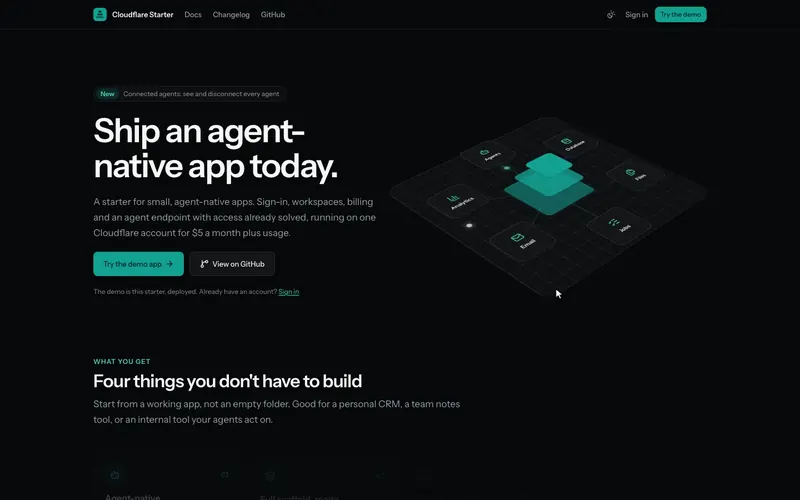
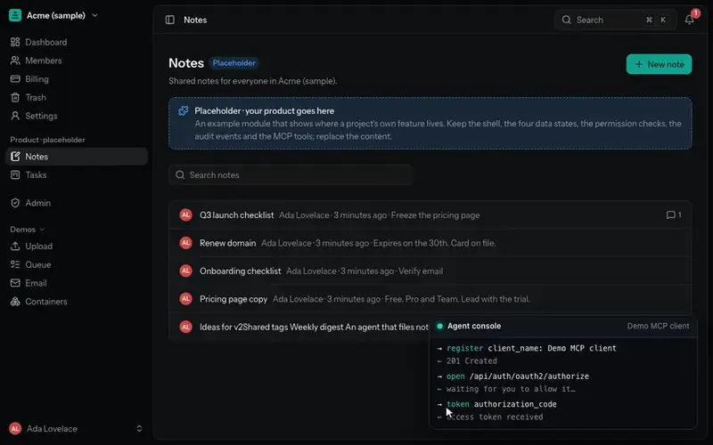
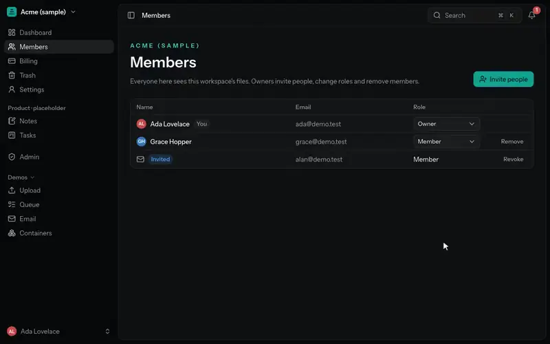
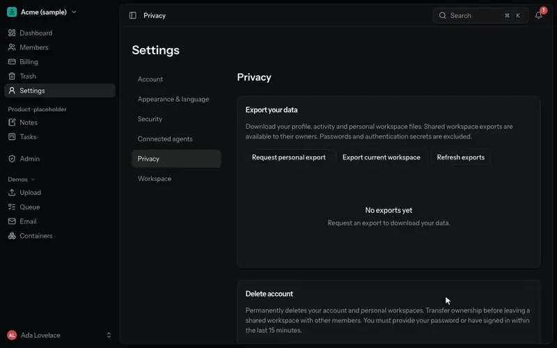
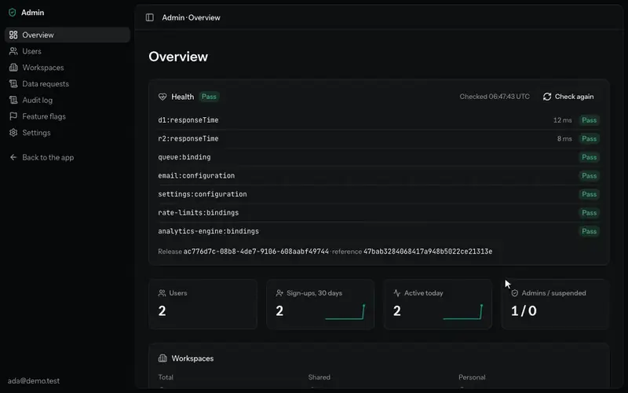

<p align="center">
  <a href="https://starter.flooper.me">
    <picture>
      <source media="(prefers-color-scheme: dark)" srcset="docs/assets/readme/logo-dark.svg">
      
    </picture>
  </a>
</p>

<h1 align="center">Cloudflare Starter</h1>

<h3 align="center">Ship an agent-native app today.</h3>

<p align="center">
  A starter for small, agent-native apps. Sign-in, workspaces, billing and an agent endpoint with access already solved, running on one Cloudflare account for $5 a month plus usage.
</p>

<p align="center">
  <a href="https://starter.flooper.me/sign-up"></a>
  <a href="https://starter.flooper.me/docs/"></a>
  <a href="https://starter.flooper.me"></a>
  <a href="https://github.com/flooper68/cloudflare-starter/actions/workflows/ci.yml"></a>
</p>

<p align="center">
  <a href="https://starter.flooper.me">
    
  </a>
</p>

## What you get

<table>
  <tr>
    <td width="50%" valign="top">
      <h3>01 · Agent-native</h3>
      <p>Your agents use the app the way your users do, with access already solved.</p>
      <p><sub>MCP with OAuth · a consent page · the same permissions as the user · see and disconnect agents</sub></p>
      
      <p><a href="https://starter.flooper.me/docs/features/agents/">Agents and MCP →</a></p>
    </td>
    <td width="50%" valign="top">
      <h3>02 · Full scaffold, ready</h3>
      <p>The parts every app needs are built, tested and documented. Keep what you use.</p>
      <p><sub>Passkeys and two-factor · workspaces, invites and roles · plans, trials and limits · admin portal</sub></p>
      
      <p><a href="https://starter.flooper.me/docs/features/workspaces/">Workspaces, roles and billing →</a></p>
    </td>
  </tr>
  <tr>
    <td width="50%" valign="top">
      <h3>03 · Everything a full app needs</h3>
      <p>Background work, email, files and flags without adding another service.</p>
      <p><sub>Scheduled tasks · a job queue with retries · email · file storage · feature flags · containers (demo)</sub></p>
      
      <p><a href="https://starter.flooper.me/docs/features/jobs-and-email/">Jobs, schedules and email →</a></p>
    </td>
    <td width="50%" valign="top">
      <h3>04 · Infra solved</h3>
      <p>Production-ready from day one, so you don't have to think about it.</p>
      <p><sub>Cookieless analytics · logs, metrics and traces · health checks · 30-day database restore</sub></p>
      
      <p><a href="https://starter.flooper.me/docs/features/observability/">Analytics, logs and health →</a></p>
    </td>
  </tr>
</table>

<details>
<summary><b>Every feature, by pillar</b></summary>

<!-- generated:features -->

60 built, 1 demo, 1 planned.

**Agent-native**

- [Agents & MCP](https://starter.flooper.me/docs/features/agents/): Agent endpoint · Agent sign-in and consent · Tokens tied to the browser · Connected agents · A tool for every API · Admin tools for agents · Untrusted-data wrapping
- [Built for coding agents](https://starter.flooper.me/docs/start/): AGENTS.md and the docs index · Agent skills · Setup scripts and doctor · Tests at every layer · Architecture tests · Accessible component library · Docs site with search · Smoke suite and QA checklist · CI, with optional self-hosted runners · Pinned dependencies and a bundle budget

**Full scaffold, ready**

- [Accounts & security](https://starter.flooper.me/docs/features/accounts/): Email, password and Google sign-in · Email verification and password reset · Passkeys · Two-factor · Fresh second factor for admin actions · Account settings · Rate limits on every action · Bot check on sign-up and sign-in · Strict security headers
- [Workspaces, billing & admin](https://starter.flooper.me/docs/features/workspaces/): Workspaces · Open or invite-only sign-up · Invitations by email · Roles from one permission map · Members page and workspace switcher · Workspace settings · Plans and usage limits · Trials · Billing off, manual or a provider · Admin portal · Impersonation · Workspace rescue
- [Privacy & data](https://starter.flooper.me/docs/features/privacy/): Data export · Account erasure · Privacy data catalog · Trash · Storage reconciliation · Audit log · Security notices

**Everything a full app needs**

- [App platform](https://starter.flooper.me/docs/features/notes/): Notes, the example feature · Command palette · Notifications · Email · File storage · Background jobs · Scheduled tasks · Feature flags · Typed API and a REST example · Containers _(demo)_ · Container tasks from jobs _(planned)_

**Infra solved**

- [Observability & ops](https://starter.flooper.me/docs/features/observability/): Product analytics · Cookieless web analytics · Logs and error reports · Metrics and traces · Health checks · 30-day database restore

<!-- /generated:features -->

What changed, release by release: the [changelog](CHANGELOG.md).

</details>

## Start in one prompt

Paste this into Claude Code or your coding agent in an empty folder, with your app's name for `<name>`:

```text
Create a new agent-native app called <name> from the template https://github.com/flooper68/cloudflare-starter. Read its AGENTS.md first, then follow its start-project skill (.claude/skills/start-project/SKILL.md). Ask me for each decision it needs, and before every change to my GitHub or Cloudflare account.
```

It creates your repository from the template, strips what only the starter needs, brands the app, sets up Cloudflare and deploys, asking before every change to your accounts. [What it does](docs/guides/how-to-start-a-project.md).

## What it costs

**$5 a month**, Cloudflare's Workers Paid plan. A small app stays inside the included allowances; above them you pay per use.

<!-- generated:costs -->

| What                  | Included every month          | Above that               |
| --------------------- | ----------------------------- | ------------------------ |
| App, API and agents   | 10M requests                  | then $0.30 / million     |
| Database              | 5 GB · 25B reads · 50M writes | then $1 / million writes |
| File storage          | 10 GB · free egress           | then $0.015 / GB-month   |
| Jobs and schedules    | 1M queue ops                  | then $0.40 / million     |
| Email                 | 3,000 emails                  | then $0.35 / 1,000       |
| Analytics and metrics | 10M data points               | not billed yet           |
| Logs                  | 20M events                    | then $0.60 / million     |
| Bot checks            | unlimited                     | free                     |

Prices from Cloudflare's docs, checked 8 Nov 2026. Your domain is extra.

<!-- /generated:costs -->

[What you reach first](docs/start/what-it-costs.md)

## Read more

<table>
  <tr>
    <td width="50%" valign="top">
      <a href="docs/architecture/overview.md"></a>
      <p><b><a href="docs/architecture/overview.md">Architecture</a></b>: one Worker, its bindings and how a request flows, in diagrams.</p>
    </td>
    <td width="50%" valign="top">
      <p><b><a href="docs/processes/agentic-workflow.md">Agentic workflow</a></b>: an orchestrator agent leads, implementers build in their own worktrees, a reviewer checks risky diffs, and you approve. With the <a href="docs/processes/agent-skills.md">skills and subagents</a> and the <a href="docs/README.md#processes">processes</a>.</p>
      <p><b><a href="docs/reference/ci.md#self-hosted-runners">Local GitHub runners</a></b> (optional): run CI on your own machine, self-hosted runners in Docker with <code>bun run runner:up</code>.</p>
      <p><b><a href="docs/start/README.md">Develop</a></b>: requirements, the first run, the scripts and deployment.</p>
      <p><b><a href="docs/README.md">All docs</a></b>: every guide, each with when to read it.</p>
    </td>
  </tr>
</table>

## Under the hood

Astro and React on Cloudflare Workers, D1 with Drizzle, R2, Queues, Cron Triggers, Email Service, Analytics Engine, Turnstile, Rate Limiting, Better Auth and tRPC, on Bun.

## License

No license has been chosen yet.
