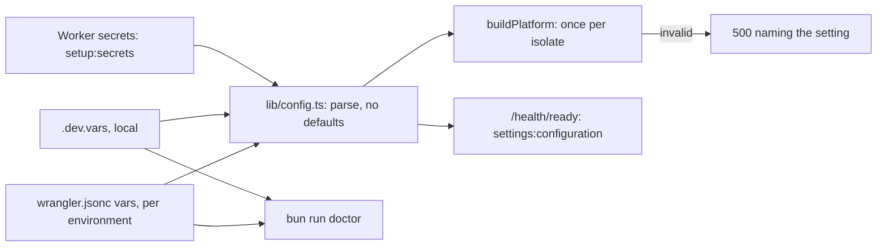
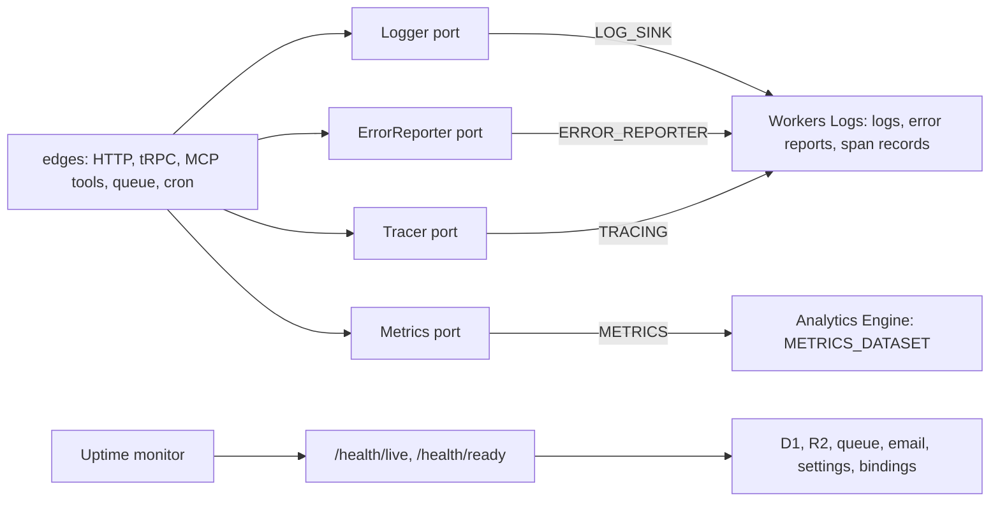
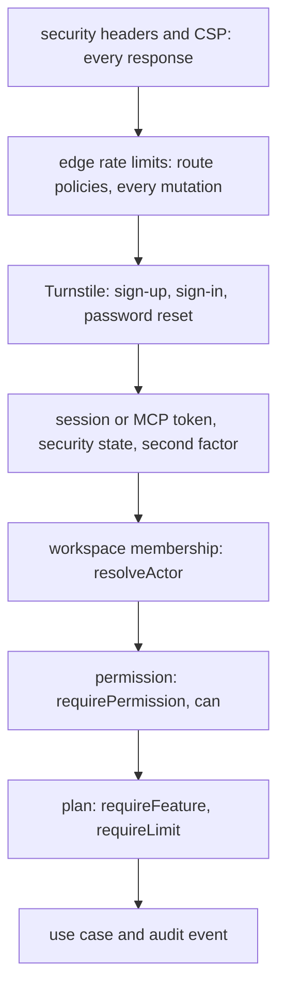
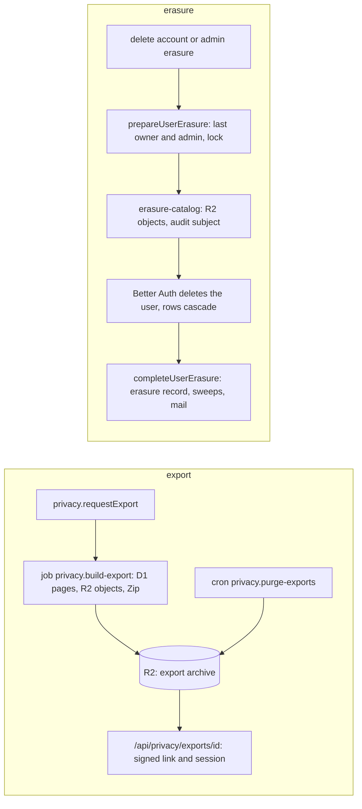
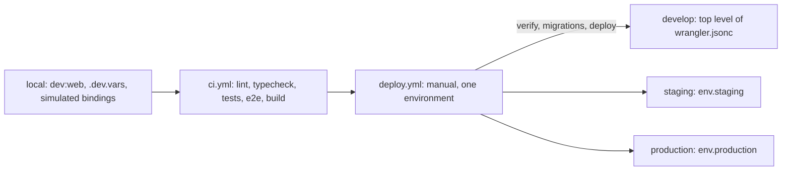

# Cross-cutting concerns

The concerns every feature shares, one picture each: settings, observability, security layers, privacy and environments. Use when you add a setting, a log line or metric, a check on a request, a table that holds personal data, or a deploy step, and want to see where it fits.

## Settings

A required setting (`LOG_SINK`, `METRICS`, `RATE_LIMITING`, `BILLING`, …) has no default: every environment states it, and the app refuses to guess. "Validated at startup" means at the first request of each isolate, since a Worker has no boot step of its own. Code: [lib/config.ts](../../apps/web/src/lib/config.ts), [server/platform.ts](../../apps/web/src/server/platform.ts), [scripts/doctor.ts](../../scripts/doctor.ts), [server/health.ts](../../apps/web/src/server/health.ts). The list of settings: [Environments and bindings](overview.md#environments-and-bindings).

## Observability

Use cases are never instrumented; they get a logger bound to the trace, and the edges measure them. The trace id is the `x-request-id` on every response and the `reference` in every 500, so one search in Workers Logs finds a request's logs, spans and error report. Guides: [how-to-setup-logging.md](../guides/how-to-setup-logging.md), [how-to-setup-error-reporting.md](../guides/how-to-setup-error-reporting.md), [how-to-setup-metrics-and-tracing.md](../guides/how-to-setup-metrics-and-tracing.md), [how-to-monitor-health.md](../guides/how-to-monitor-health.md).

## Security layers

Not every request meets every layer: Turnstile guards only the account forms, and pages are not rate limited except the token pages. Each layer has a test that fails when something new skips it: `test/architecture/security-headers.test.ts`, `abuse.test.ts`, `workspace-scope.test.ts`, `entitlements.test.ts` and `audit-coverage.test.ts`. Code: [security-headers.ts](../../apps/web/src/server/security-headers.ts), [abuse/domain/policies.ts](../../packages/features/src/abuse/domain/policies.ts), [trpc/init.ts](../../apps/web/src/server/trpc/init.ts), [workspaces/domain/permissions.ts](../../packages/features/src/workspaces/domain/permissions.ts). Guides: [how-to-configure-security-headers.md](../guides/how-to-configure-security-headers.md), [how-to-configure-abuse-protection.md](../guides/how-to-configure-abuse-protection.md), [how-to-configure-account-security.md](../guides/how-to-configure-account-security.md).

## Privacy: export and erasure

`DATA_CATALOG` names, for every table, the columns an export contains and how erasure treats it, and `test/architecture/privacy.test.ts` fails for a table it misses. Code: [privacy/](../../packages/features/src/privacy/), [data-catalog.ts](../../packages/features/src/data-catalog.ts), [erasure-catalog.ts](../../packages/features/src/erasure-catalog.ts). Guide: [how-to-handle-data-privacy.md](../guides/how-to-handle-data-privacy.md).

## Environments

Bindings are not inherited between environments, so each section declares all of them; `test/architecture/wrangler.test.ts` checks that. Migrations go out before the code that needs them. Code: [apps/web/wrangler.jsonc](../../apps/web/wrangler.jsonc), [.github/workflows/deploy.yml](../../.github/workflows/deploy.yml). Guides: [how-to-setup-web-app.md](../guides/how-to-setup-web-app.md), [how-to-setup-ci.md](../guides/how-to-setup-ci.md), [how-to-qa-a-deployment.md](../guides/how-to-qa-a-deployment.md).
