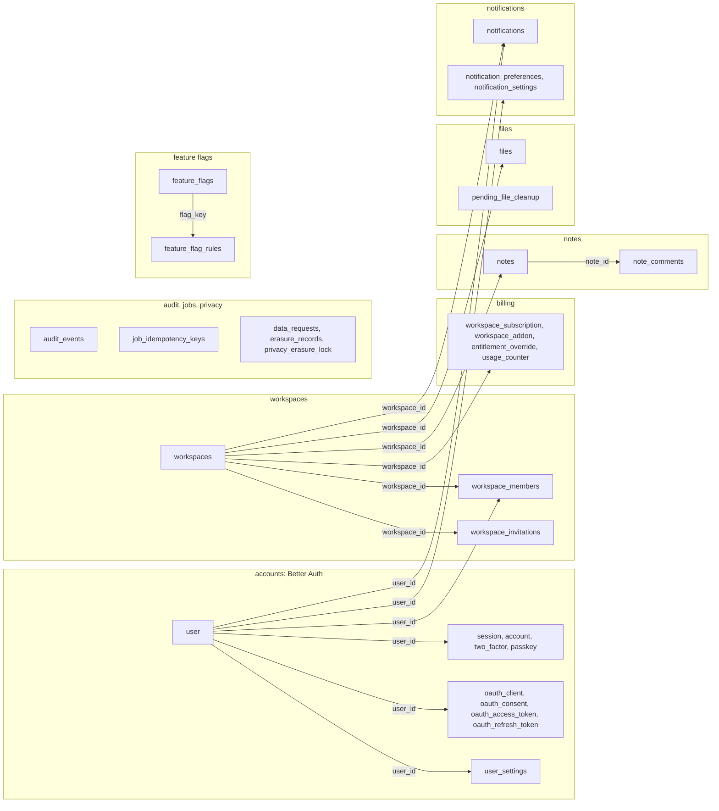

# Data model

The D1 tables grouped by the feature that owns them, with the foreign keys that matter for tenancy and deletion. Use when you add a table, trace what a user or workspace deletion removes, or look for the table behind a feature.

## Tables by feature

Every arrow is a foreign key with `ON DELETE CASCADE`: deleting a workspace removes its rows, deleting a user removes their credentials, memberships and preferences. Authorship columns (`created_by`, `updated_by`, `deleted_by`, `invited_by`) point at `user` with `ON DELETE SET NULL` and are left out of the diagram. The tables in "audit, jobs, privacy" and `pending_file_cleanup` have no foreign keys on purpose: they record or finish work after a deletion. Not shown: Better Auth's `verification`, `jwks`, `rate_limit`, `oauth_resource`, `oauth_client_resource` and `oauth_client_assertion`.

The tables are defined in each feature's `*.schema.ts` (for example [notes.schema.ts](../../packages/features/src/notes/notes.schema.ts)), collected in [database.ts](../../packages/features/src/database.ts) and generated into [migrations/](../../packages/features/migrations/). The `workspace_id` rule and its exemptions: [Tenancy and authorization](overview.md#tenancy-and-authorization), `test/architecture/workspace-scope.test.ts`. What each table exports and how it is erased: [data-catalog.ts](../../packages/features/src/data-catalog.ts), [how-to-handle-data-privacy.md](../guides/how-to-handle-data-privacy.md). Changing the schema: [how-to-setup-d1.md](../guides/how-to-setup-d1.md).
