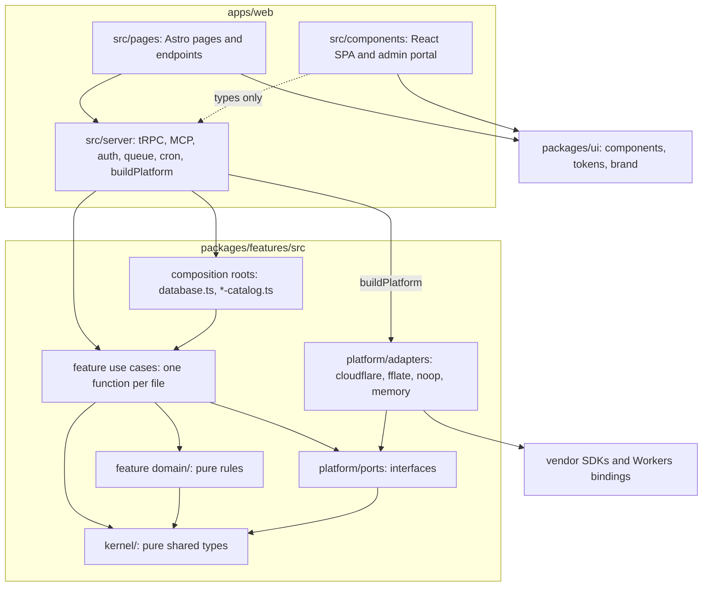

# Layers

The layers of the monorepo and which may import which, with the lint rule or test that fails the build when an import breaks a rule. Use when you decide where new code goes, or a dependency-cruiser, GritQL or architecture-test failure names a layer rule.

## Who may import whom

Read an arrow as "may import". Anything without an arrow is forbidden: a feature never imports `packages/ui`, `platform/` never imports a feature, `domain/` never does I/O, and `apps/web` never queries D1 itself. A feature imports another feature only through its `index.ts`. The code: [apps/web/src/server/](../../apps/web/src/server/), [packages/features/src/](../../packages/features/src/), [packages/ui/src/](../../packages/ui/src/); the rules in prose: [Principles](overview.md#principles).

## What enforces each rule

Most layer rules are lint rules that `bun run lint` runs (Biome, its GritQL plugins in `lint/rules/`, and dependency-cruiser in `.dependency-cruiser.cjs` through `bun run deps:check`); the rest are tests in `test/architecture/`. CI fails on any of them.

| Rule                                                                          | Enforced by                                                                        |
| ----------------------------------------------------------------------------- | ---------------------------------------------------------------------------------- |
| No import cycles                                                              | Biome `noImportCycles`; dependency-cruiser `no-circular`                           |
| `kernel/` imports nothing else                                                | dependency-cruiser `kernel-is-pure`                                                |
| `domain/` imports only its own domain, `kernel/` and zod; no I/O, time or ids | dependency-cruiser `domain-is-pure`; `lint/rules/domain-purity.grit`               |
| `platform/` never imports a feature or a composition root                     | dependency-cruiser `platform-does-not-know-features`                               |
| A folder is imported only through its `index.ts`                              | dependency-cruiser `features-only-through-barrels`; Biome `noReExportAll`          |
| `packages/features` and `packages/ui` never import each other                 | dependency-cruiser `features-not-ui`, `ui-not-features`                            |
| Packages never import apps                                                    | dependency-cruiser `packages-not-apps`                                             |
| Vendor SDKs only in `platform/adapters/<vendor>/`                             | dependency-cruiser `vendor-sdks-only-in-adapters`, `vendor-sdks-not-in-app-server` |
| Every adapter passes its port's contract suite                                | `test/architecture/test-presence.test.ts`                                          |
| Only the Cloudflare adapters write to the console                             | `lint/rules/no-console.grit`                                                       |
| No database access in `apps/web`                                              | Biome `noRestrictedImports` (`drizzle-orm`); `lint/rules/no-db-in-adapters.grit`   |
| A use-case file exports one function                                          | `test/architecture/use-cases.test.ts`                                              |
| Queue messages only through `enqueueJob`                                      | `lint/rules/no-direct-queue-send.grit`; `test/architecture/jobs.test.ts`           |
| `AsyncLocalStorage` only at the Better Auth edge                              | `lint/rules/request-scope-at-auth-edge.grit`                                       |
| Workspace data is reached through a `workspaceProcedure` and the actor        | `test/architecture/workspace-scope.test.ts`                                        |
| Every tRPC procedure has an MCP tool or a reasoned exemption                  | `apps/web/src/server/mcp/parity.test.ts`                                           |
| UI uses theme tokens only                                                     | `lint/rules/tokens-only.grit`                                                      |
| Dependencies are pinned exactly                                               | `test/architecture/dependencies.test.ts`                                           |

dependency-cruiser checks `packages/features/src`, `packages/ui/src` and `apps/web/src/server`; the SPA under `apps/web/src/components` is held to the same direction by review and by `packages/ui` being the only component source. A failing rule names its file; [overview.md](overview.md#principles) says why the rule exists.
