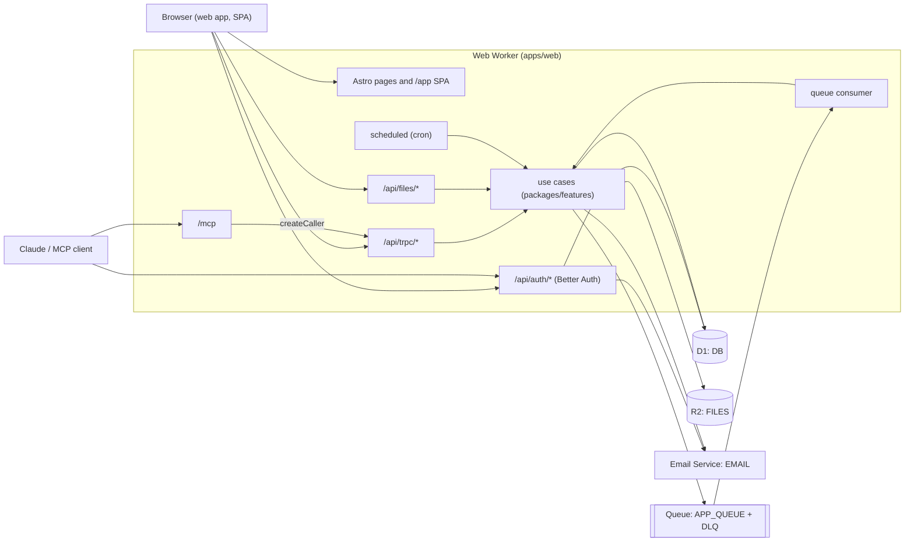

# Architecture Overview

How the starter is built and the rules every change follows: the parts, how a request moves through them, the environments, the architecture principles, and checklists for extending the system. It describes the target shape; the [Current state vs target](#current-state-vs-target) section lists where the code still differs. Use when you plan a change, review one, or need to know where something belongs.

## Parts

| Part            | Location                                         | What it is                                                                                                                                                                                                                                                                                                                                                                       |
| --------------- | ------------------------------------------------ | -------------------------------------------------------------------------------------------------------------------------------------------------------------------------------------------------------------------------------------------------------------------------------------------------------------------------------------------------------------------------------- |
| Web Worker      | [apps/web](../../apps/web/README.md)             | The one deployed Worker: Astro SSR pages, the React SPA under `/app/*`, Better Auth, tRPC, REST routes, `/mcp`, the queue consumer and cron                                                                                                                                                                                                                                      |
| Worker entry    | `apps/web/src/worker.ts`                         | `fetch` (Astro handler), `queue` and `scheduled` handlers in one export                                                                                                                                                                                                                                                                                                          |
| Server adapters | `apps/web/src/server/`                           | Auth config, tRPC routers, MCP endpoint and tools, queue consumer and cron handler. Thin: they parse, authorize, call use cases, map errors                                                                                                                                                                                                                                      |
| HTTP routes     | `apps/web/src/pages/`                            | Astro pages (`.astro`) and endpoints (`.ts`): `/api/auth/*`, `/api/trpc/*`, `/api/files/*`, `/api/hello`, `/.well-known/*`, `/mcp`                                                                                                                                                                                                                                               |
| Features        | `packages/features/src/<feature>/`               | Vertical slices of server logic: pure `domain/`, one use case per file, the feature's Drizzle tables. `jobs/` is background jobs: envelope, retries, idempotency, cron types                                                                                                                                                                                                     |
| Platform        | `packages/features/src/platform/`                | Shared infrastructure the features receive as dependencies: D1 client, email service, ids, clock, random, request context; the ports (Logger, ErrorReporter, Metrics, Tracer, JobQueue, FeatureFlags, RateLimiter, HumanVerifier) and their adapters ([Ports and adapters](#ports-and-adapters))                                                                                 |
| Composition     | `apps/web/src/server/platform.ts`                | `buildPlatform(env)`: picks one adapter per port from `LOG_SINK`, `ERROR_REPORTER`, `FEATURE_FLAGS`, `METRICS` and `TRACING`, builds the JobQueue on `APP_QUEUE`, once per isolate. `packages/features/src/job-catalog.ts` and `cron-catalog.ts` list every job and cron entry; `server/billing-provider.ts` builds the BillingGate and picks the BillingProvider from `BILLING` |
| Migrations      | `packages/features/migrations/`                  | SQL generated by drizzle-kit, applied by Wrangler                                                                                                                                                                                                                                                                                                                                |
| UI library      | [packages/ui](../../packages/ui/README.md)       | Components on Radix + Tailwind tokens, brand in `src/brand/`; stories next to components                                                                                                                                                                                                                                                                                         |
| Storybook       | [apps/storybook](../../apps/storybook/README.md) | Storybook config; the build is served by the web Worker at `/_storybook/`                                                                                                                                                                                                                                                                                                        |
| Container demo  | [apps/container](../../apps/container/README.md) | A separate Worker with a Cloudflare Container, deployed on its own                                                                                                                                                                                                                                                                                                               |
| Setup scripts   | `scripts/`                                       | `setup:cloudflare`, `setup:secrets`, `setup:auth`, `setup:email`, `doctor`; `runner:*` for the self-hosted CI runners; `ci-*` helpers used by CI                                                                                                                                                                                                                                 |
| CI runner image | `ops/runner/`                                    | Dockerfile, entrypoint and Compose file of the self-hosted GitHub Actions runners (`runner:up`)                                                                                                                                                                                                                                                                                  |
| CI and deploy   | `.github/workflows/`                             | `ci.yml` (lint, typecheck, test, components, e2e, migrations, build, deploy dry-run) and `deploy.yml` (manual, per environment)                                                                                                                                                                                                                                                  |
| Agent skills    | `.claude/skills/`                                | `setup-auth`, `setup-d1`, `setup-email`                                                                                                                                                                                                                                                                                                                                          |

## Runtime



## Main flows

**Request context.** Every unit of work gets a `RequestContext` at its edge (`packages/features/src/kernel/request-context.ts`): `middleware.ts` builds it for every on-demand HTTP request (`apps/web/src/server/app-middleware.ts`, `http.ts`), the queue consumer for each message, the scheduled handler for each run. Its identity is a [W3C Trace Context](https://www.w3.org/TR/trace-context/): a `traceId` (continued from a valid incoming `traceparent`, else new; correlation only, never trusted) and its own `spanId`. There is no separate request id: the trace id is the reference, returned on every HTTP response as `x-request-id` next to `traceparent`, carried as `traceparent` by queue messages so the consumer continues the trace, and on every log record and error report (`trace_id`, `span_id`). An incoming `x-request-id` is ignored. An unexpected failure answers 500 with `reference` (the trace id) instead of the error; tRPC puts it in `error.data.reference`, MCP tool errors and the file routes in `reference`, and `ErrorState` shows it.

**Web request with a session.** `middleware.ts` resolves the Better Auth cookie into `Astro.locals.user`; anonymous `/app/*` requests redirect to `/sign-in`. The SPA calls `/api/trpc/*` with the `x-trpc-source: app` header (POSTs without it get 403). The tRPC context carries the user and the platform deps; a `protectedProcedure` refuses requests without a user, and a `workspaceProcedure` also resolves the actor (user, workspace, role) for the request's workspace and adds the workspace to the request context. The procedure calls a use case.

**MCP request.** The client discovers the OAuth server through `/.well-known/*`, registers, sends the user through `/sign-in` and `/consent`, and gets a JWT bound to `<APP_URL>/mcp`. `/mcp` verifies the token with the in-process JWKS, reloads the user from D1, builds `appRouter.createCaller(context)` for that user and serves the tools. Each tool calls procedures in-process: same input schema, auth check and errors as the web app. Results wrap user data in `<untrusted-data>`.

**Background job.** A feature declares a job with `defineJob` (type, zod payload, backoff, optional idempotency key) in its domain and registers its handler, a use case, in `packages/features/src/job-catalog.ts`. A use case enqueues it with `enqueueJob`, which validates the payload and sends a CloudEvents envelope carrying the caller's `traceparent`, user and workspace (a workspace procedure's `ctx.requestContext` carries the actor's workspace) through the JobQueue port to `APP_QUEUE`; nothing else sends to the queue. The `queue` handler (`apps/web/src/server/queue.ts`) parses each envelope, continues the producer's trace, runs the job (claiming its idempotency key in D1 first, if it has one) and acks it. A failure is retried with the job's exponential backoff (`retry({ delaySeconds })`); a permanent failure (malformed, unknown type, invalid payload, `DomainError` of kind invalid_input, forbidden, not_found) is reported and acked; a failure on the final attempt is reported and goes to the dead-letter queue, which has no consumer and keeps messages 14 days. No job history is stored. [how-to-add-background-jobs.md](../guides/how-to-add-background-jobs.md)

**Cron.** `triggers.crons` in `wrangler.jsonc` fires `scheduled`; the handler (`apps/web/src/server/cron.ts`) runs every entry of the cron catalog (`packages/features/src/cron-catalog.ts`) whose schedule equals `controller.cron` (several entries may share one schedule, listed once in `triggers.crons`), each in a new trace with `controller.scheduledTime` as its time. Entries fan out by enqueueing jobs (the daily `audit.purge-events`, `jobs.purge-idempotency-keys`, `billing.expire-trials` and `trash.purge-expired`). A failing entry is reported, the others still run, and the run fails.

**Rate-limited or human-checked request.** `/api/auth/*`, `/mcp` and `POST /api/files` count the request against their edge policy first and answer 429 (Problem Details, `Retry-After`, `RateLimit` header fields) when it is over; every tRPC mutation does the same in the `limitMutations` middleware (TOO_MANY_REQUESTS). Better Auth then applies its own per-path limits and, on sign-up, sign-in and password reset, verifies the Turnstile token. See [Abuse protection](#abuse-protection).

**Audit event.** A use case that changes state records an audit event with `recordAuditEvent` after the change, passing its request context; Better Auth's sign-in, failed sign-in, sign-up, password reset request and password change are recorded from hooks in `apps/web/src/server/auth-audit.ts`. See [Audit log](#audit-log).

## Environments and bindings

| Environment | Where it is configured                 | Built with                             | Secrets from                     |
| ----------- | -------------------------------------- | -------------------------------------- | -------------------------------- |
| local       | top level of `apps/web/wrangler.jsonc` | `bun run dev:web` (simulated bindings) | `apps/web/.dev.vars`             |
| develop     | top level of `apps/web/wrangler.jsonc` | `bun run deploy`                       | Worker secrets (`setup:secrets`) |
| staging     | `env.staging`                          | `CLOUDFLARE_ENV=staging` at build      | Worker secrets                   |
| production  | `env.production`                       | `CLOUDFLARE_ENV=production` at build   | Worker secrets                   |

Bindings of the web Worker, declared in every environment: `DB` (D1), `FILES` (R2), `EMAIL` (`send_email`), `APP_QUEUE` (queue producer) plus the queue consumer (`max_retries` 5) and its dead-letter queue (no consumer; 14 days of retention set by `setup:cloudflare`), `CF_VERSION_METADATA` (`version_metadata`, the `release` in logs), `METRICS_DATASET` (Workers Analytics Engine, one dataset per environment), the Workers Rate Limiting bindings `RL_AUTH_IP`, `RL_MUTATION`, `RL_MCP_IP`, `RL_MCP_USER`, `RL_UPLOAD`, `RL_INVITE`, `RL_TOKEN_LOOKUP`, `RL_BILLING_WEBHOOK` (`ratelimits`), and `triggers.crons`; `observability` (Workers Logs with invocation logs, and traces) is also declared in each. Vars: `APP_ENV`, `LOG_SINK`, `ERROR_REPORTER`, `FEATURE_FLAGS`, `METRICS` and `TRACING` (all required, no defaults; `APP_ENV` is `local` only in `.dev.vars`: [how-to-setup-logging.md](../guides/how-to-setup-logging.md), [how-to-setup-metrics-and-tracing.md](../guides/how-to-setup-metrics-and-tracing.md), [how-to-use-feature-flags.md](../guides/how-to-use-feature-flags.md#feature_flags)), `AUTH_EMAIL_PASSWORD`, `AUTH_REQUIRE_EMAIL_VERIFICATION`, `EMAIL_FROM_NAME`, `EMAIL_FROM` (written by `setup:email`), `RATE_LIMITING`, `TURNSTILE` and `TURNSTILE_SITE_KEY` (required, no defaults: [how-to-configure-abuse-protection.md](../guides/how-to-configure-abuse-protection.md)), and the workspace settings `WORKSPACE_MODE`, `SIGN_UP` (required, no defaults), `SIGN_UP_DOMAINS`, `BOOTSTRAP_ADMIN_EMAIL`, and `BILLING` (`off`, `manual` or `provider`, required, no default; [how-to-configure-plans-and-billing.md](../guides/how-to-configure-plans-and-billing.md)): not shipped, written per environment by `setup:auth` and exempt with `EMAIL_FROM` from the same-vars-everywhere test ([how-to-configure-workspaces.md](../guides/how-to-configure-workspaces.md)). Secrets: `APP_URL`, `BETTER_AUTH_SECRET`, `TURNSTILE_SECRET_KEY` (with `TURNSTILE=on`), optional `GOOGLE_CLIENT_ID`/`GOOGLE_CLIENT_SECRET` and `R2_*`; the list with comments is in `apps/web/.dev.vars.example`. Setup steps: [how-to-setup-web-app.md](../guides/how-to-setup-web-app.md).

## Principles

Each principle is the rule that holds now; a project records why it changes one in an ADR ([adrs.md](../processes/adrs.md)). "(enforced in CI)" means a tool fails the build when the rule is broken; reviewers do not re-check those by hand when CI is green.

1. **One concept per file.** One use case, one component, one schema module per file. A small, tightly bound family (`Card` + `CardHeader`) may share a file. Architecture test: a use-case file exports exactly one runtime function (enforced in CI).
2. **Barrels are the public API.** Every feature and folder has an `index.ts` that lists its exports explicitly. Code outside a feature imports only from its barrel, never a deep path. `export *` is allowed only in the package roots (`packages/*/src/index.ts`) re-exporting folder barrels; `packages/features/src/database.ts` is the one module that imports feature internals (their `*.schema.ts`). Biome `noReExportAll` and dependency-cruiser's `features-only-through-barrels` (enforced in CI).
3. **No import cycles.** Biome `noImportCycles` (enforced in CI).
4. **Dependencies point inward: apps → features → domain.** `domain/` is pure: no I/O, no `fetch`, no `Date.now()` or argument-less `new Date()`, no `crypto.randomUUID()`, no env, no `console`. Time, ids and I/O are passed in as `Clock`/`Ids`/bindings. `domain/` imports only its own domain, `kernel/` (pure shared types) and zod; `platform/` never imports a feature; `packages/ui` and `packages/features` never import each other. GritQL rule `lint/rules/domain-purity.grit` and dependency-cruiser (`bun run deps:check`, part of `bun run lint`) (enforced in CI).
5. **Server code is organised by feature; apps are thin adapters.** See [Feature layout](#feature-layout). tRPC procedures, MCP tools, HTTP routes, the queue consumer and cron handlers parse input, check auth, call a use case and map its typed errors. They hold no business logic and make no DB calls. Use cases throw `DomainError` subclasses (`kind`: not_found, invalid_input, forbidden, conflict, unavailable, rate_limited, limit_reached; an optional `code` and `details` for clients); `apps/web/src/server/trpc/domain-errors.ts` maps them for tRPC, `server/http.ts` `domainErrorResponse` for HTTP routes. Biome `noRestrictedImports` (no `drizzle-orm` in `apps/web`) and `lint/rules/no-db-in-adapters.grit` (enforced in CI).
6. **Every API is reachable through MCP.** Every tRPC procedure has an MCP tool or an exemption with a reason; every non-tRPC endpoint under `apps/web/src/pages` is listed in `NON_TRPC_ROUTES` with a reason. `apps/web/src/server/mcp/parity.test.ts` (enforced in CI). [how-to-setup-mcp.md](../guides/how-to-setup-mcp.md)
7. **Bindings over keys.** Use Worker bindings (D1, R2, `send_email`, queues) where they exist; secrets live in `.dev.vars` and Worker secrets, never in code, config or command arguments.
8. **`wrangler.jsonc` per environment.** Bindings and vars are not inherited by `env.*`; each environment declares all of them. The environment is chosen at build time with `CLOUDFLARE_ENV`. Architecture test: every binding exists in all environments, and `observability` and `version_metadata` are the same in each (enforced in CI).
9. **Migrations are additive.** Add columns and tables; drop or rename only in a later change once no deployed code uses them. Generated by `bun run db:generate`, applied by Wrangler, never `drizzle-kit push` to a remote database. CI checks migrations are in sync with the schema and apply to an empty D1; an architecture test requires a `-- contract: <reason>` line in any migration with `DROP` or `RENAME` (enforced in CI). The starter itself has no deployed data: it keeps one `0000_init` migration and regenerates it from the schema; a project built from it switches to additive migrations from its first deploy and never edits an applied migration.
10. **Exact dependency pins.** `bunfig.toml` sets `exact = true`; architecture test rejects `^`/`~` ranges (enforced in CI). Updating and auditing: [dependencies.md](../processes/dependencies.md).
11. **One Worker** for HTTP, queue consumer and cron; split only for separate scaling, limits or deploys.
12. **UI is token-only.** Components use theme tokens, never raw palette classes or hex values; brand lives in `packages/ui/src/brand/`. `lint/rules/tokens-only.grit` (enforced in CI). [packages/ui/CONVENTIONS.md](../../packages/ui/CONVENTIONS.md)
13. **Outside services only through a port.** Logging, error reporting, metrics, tracing and every later outside service (rate limiting, analytics, feature flags, billing) are reached through an interface in `packages/features/src/platform/ports/`; vendor code lives only in `platform/adapters/<vendor>/`, and only the Cloudflare adapters write to the console. See [Ports and adapters](#ports-and-adapters). Dependency-cruiser `vendor-sdks-only-in-adapters` (packages/features outside an adapter folder imports only zod, drizzle-orm and aws4fetch) and `vendor-sdks-not-in-app-server` (a denylist of vendor SDKs in `apps/web/src/server`), GritQL `lint/rules/no-console.grit` (packages/features and `apps/web/src/server`, tests and the Cloudflare adapters aside), and `test/architecture/test-presence.test.ts` (every adapter runs its port's contract suite) (enforced in CI).
14. **Dependencies are explicit; no ambient request state.** Code receives the `RequestContext`, clock, ids and bindings as arguments; nothing reads them from a global or from `AsyncLocalStorage`. One exception, at the adapter edge: Better Auth calls its hooks itself and gives them no way to receive our context, so `apps/web/src/server/request-scope.ts` keeps the current request's context in an `AsyncLocalStorage` that `withRequestContext` (`server/http.ts`) sets and only `server/auth-audit.ts` reads, to give audit events the request's trace id. A new library callback that needs the context goes through the same bridge only with a reason in the PR. GritQL `lint/rules/request-scope-at-auth-edge.grit` (no `AsyncLocalStorage`, `node:async_hooks` or `request-scope` import in packages/features or apps/web outside those three files) (enforced in CI).
15. **Data belongs to a workspace.** Every table has a non-null `workspace_id` (auth tables, the `workspaces` table and the platform tables `audit_events` and `job_idempotency_keys` excepted), every procedure on data is a `workspaceProcedure`, and use cases take the actor and check `can()`. See [Tenancy and authorization](#tenancy-and-authorization). `test/architecture/workspace-scope.test.ts` (enforced in CI).
16. **Background work only through `enqueueJob`.** Jobs are declared with `defineJob`, registered in the job catalog and enqueued with `enqueueJob`; scheduled work is an entry of the cron catalog that enqueues jobs. No code reads `APP_QUEUE` or calls `.send(` on a queue outside `packages/features/src/jobs/`, the Cloudflare JobQueue adapter and `buildPlatform`. Every consumer has a dead-letter queue and `max_retries` equal to `JOB_MAX_RETRIES`; `triggers.crons` equals the cron catalog's schedules in every environment. GritQL `lint/rules/no-direct-queue-send.grit` and `test/architecture/jobs.test.ts` (enforced in CI). [how-to-add-background-jobs.md](../guides/how-to-add-background-jobs.md)
17. **Trashed rows never reach a live read.** A trashable table (one of `TRASH_CATALOG`, `packages/features/src/trash-catalog.ts`) has `deleted_at` and `deleted_by`; every read of it goes through `liveIn(table, actor)` or `trashedIn(table, actor)` (`trash/`), never a bare workspace filter, unless the file is listed with a reason (erasure, the storage metric). Deleting is a move to the trash; data leaves for good only through the trash (permanent delete, empty, the daily retention purge) or erasure, which calls the entity's `purge` directly. `test/architecture/trash.test.ts` (enforced in CI). [how-to-use-trash.md](../guides/how-to-use-trash.md)

## Feature layout

```
packages/features/src/
├── index.ts                     package root: re-exports each folder barrel
├── database.ts                  composition root: all tables, Database type, createDatabase(d1)
├── job-catalog.ts               composition root: every job type and its handler
├── cron-catalog.ts              composition root: every cron entry (name, schedule, run)
├── trash-catalog.ts             composition root: every trashable entity (TRASH_CATALOG)
├── kernel/                      pure shared building blocks (domain may import these)
│   ├── domain-error.ts          DomainError with a kind adapters map, optional code and details
│   ├── billing-gate.ts          BillingGate: what features ask billing (requireFeature, requireLimit, recordUsage)
│   ├── clock.ts                 Clock interface
│   ├── ids.ts                   Ids interface
│   ├── request-context.ts       RequestContext: traceId, spanId, parentSpanId, traceFlags, source, userId, workspaceId, ip, release, environment
│   ├── job.ts                   defineJob, JobDefinition, JobBackoff, JobEnvelope (CloudEvents)
│   └── random.ts                Random interface (retry jitter)
├── platform/                    shared infrastructure, passed to use cases as deps
│   ├── ports/                   interfaces for outside services (see Ports and adapters)
│   │   ├── logger.ts            Logger port
│   │   ├── logger.contract.ts   describeLoggerContract: the suite every Logger adapter passes
│   │   ├── error-reporter.ts    ErrorReporter port
│   │   ├── error-reporter.contract.ts
│   │   ├── job-queue.ts         JobQueue port (no noop adapter)
│   │   ├── job-queue.contract.ts
│   │   ├── feature-flags.ts     FeatureFlags port (OpenFeature-shaped) and FeatureFlagStore
│   │   ├── feature-flags.contract.ts
│   │   ├── rate-limiter.ts      RateLimiter port (edge rate limits)
│   │   ├── rate-limiter.contract.ts
│   │   ├── human-verifier.ts    HumanVerifier port (Turnstile)
│   │   ├── human-verifier.contract.ts
│   │   ├── metrics.ts           Metrics port (OpenTelemetry metrics API shape)
│   │   ├── metrics.contract.ts
│   │   ├── tracer.ts            Tracer port (OpenTelemetry tracing API shape)
│   │   ├── tracer.contract.ts
│   │   ├── billing-provider.ts  BillingProvider port (checkout, portal, webhook → SubscriptionChange)
│   │   └── billing-provider.contract.ts
│   ├── adapters/                one folder per vendor, plus noop and memory
│   │   ├── cloudflare/          Workers Logs logger and error reporter (the only console writers), Queues JobQueue,
│   │   │                        D1 feature-flag provider and its tables (d1-feature-flags.schema.ts),
│   │   │                        Workers Rate Limiting RateLimiter, Turnstile HumanVerifier,
│   │   │                        Workers tracer (span records), Analytics Engine metrics
│   │   ├── noop/                the explicit "none" setting of each port
│   │   └── memory/              records what was sent, for tests
│   ├── log-record.ts            toLogRecord: OpenTelemetry log records, exception.*, redaction
│   ├── record-logger.ts         createRecordLogger: the Logger every adapter wraps with its sink
│   ├── flag-evaluation.ts       evaluateStoredFlag, flagBucket: pure rule evaluation for stored flags
│   ├── stored-flag-provider.ts  createStoredFlagProvider: the FeatureFlags port over stored flags
│   ├── metric-catalog.ts        METRIC_CATALOG: every metric's name, kind, unit, attributes; OpenMetrics names
│   ├── metric-aggregator.ts     per-series sum, count, min, max, buckets between flushes
│   ├── aggregating-metrics.ts   createAggregatingMetrics: the Metrics every adapter wraps with its backend
│   ├── span-record.ts           toSpanRecord: OpenTelemetry span records (also valid log records)
│   ├── record-tracer.ts         createRecordTracer: the Tracer every adapter wraps with its sink
│   ├── trace-context.ts         W3C traceparent: parse, format, new trace and span ids
│   ├── request-context.ts       createRequestContext, requestContextAttributes
│   ├── db.ts                    createDb(d1, schema)
│   ├── email.ts                 EmailService interface + Cloudflare implementation
│   ├── job-delay.ts             assertJobDelay: the 0..86400 s delay every JobQueue adapter enforces
│   ├── clock.ts                 systemClock
│   ├── random.ts                mathRandom
│   └── ids.ts                   randomIds
├── accounts/                    Better Auth tables (generated), findUserById
├── abuse/                       rate-limit catalog (domain/policies.ts), limitKey, enforceRateLimit, verifyHuman
├── audit/                       the append-only audit log: catalog, record, list, purge (job audit.purge-events)
├── jobs/                        background jobs: envelope schema, backoff, retry policy, idempotency
│                                keys (jobs.schema.ts), enqueueJob, runJob, purgeIdempotencyKeys, cron types
├── feature-flags/               the flag catalog (domain/catalog.ts), evaluateFlag, admin use cases
├── billing/                     plans, add-ons, features, limits: catalog in domain/, entitlements,
│                                usage counters, trials (job billing.expire-trials), admin changes, provider events
├── greetings/                   the job demo: helloJob, sendHello (enqueue), sayHello (handler)
├── trash/                       soft delete: liveIn/trashedIn, the TrashableEntity contract, list, restore,
│                                permanent delete, empty, retention purge (job trash.purge-expired)
├── workspaces/                  tenancy: workspaces, members, invitations, sign-up policy
│   ├── domain/                  permissions.ts (roles, ACTIONS, can), membership-rules.ts,
│   │                            sign-up-policy.ts, invitation.ts, mode.ts, actor.ts, config.ts
│   └── resolve-actor.ts, provision-user.ts, accept-invitation.ts, …
└── files/                       a full feature
    ├── index.ts                 public API: use cases, types, errors
    ├── files.schema.ts          its Drizzle tables
    ├── domain/                  pure, each rule with a .test.ts
    │   ├── file-key.ts          buildFileKey(workspaceId, fileId, uploadedAt)
    │   ├── upload-input.ts      zod schema + type
    │   └── errors.ts            FileNotFoundError, PresignedUrlsUnavailableError
    ├── create-file-record.ts    one use case per file
    ├── store-file.ts            (binding upload)
    ├── read-workspace-file.ts   (binding download)
    ├── create-presigned-upload.ts
    ├── create-download-url.ts
    ├── find-workspace-file.ts
    ├── list-workspace-files.ts
    ├── delete-workspace-files.ts
    ├── trash-file.ts            (move to trash)
    ├── trash.ts                 fileTrash: the files entity of the trash catalog
    └── r2-presign.ts            presignR2Url (S3 API signing)
```

A use case is one exported function whose dependencies are explicit arguments; in a workspace-scoped feature the actor comes second:

```ts
export async function createFileRecord(
  deps: { readonly db: Database; readonly clock: Clock; readonly ids: Ids },
  actor: Actor,
  input: UploadInput
): Promise<CreatedFile>;
```

Domain errors are typed classes in `domain/errors.ts`. Adapters map them to transport errors in one place (tRPC: `TRPCError` codes; HTTP routes: status codes); MCP gets the tRPC mapping for free because tools call procedures.

## Tenancy and authorization

Data belongs to a **workspace**, never to a user: every data table has a required `workspace_id`, and `created_by` (nullable, `ON DELETE SET NULL`) only records who made a row. A user reaches data through a **membership** (`workspace_members`: workspace, user, role) and the role's **permissions**, defined in one map, `ACTIONS` in `packages/features/src/workspaces/domain/permissions.ts`. The roles there are placeholders a project replaces ([how-to-configure-workspaces.md](../guides/how-to-configure-workspaces.md#replace-the-roles)).

- **Actor.** A `workspaceProcedure` (`apps/web/src/server/trpc/init.ts`) takes an optional `workspaceId`, resolves the membership with `resolveActor` and puts `ctx.actor` (`{ userId, workspaceId, role }`) on the context; a workspace the user is not a member of is NOT_FOUND. Without `workspaceId` the user's default applies (the only workspace in personal and single mode, the one switched to last in multi mode), the same for the web app and MCP. HTTP routes resolve the actor the same way (`?workspaceId=`).
- **Use cases** of workspace-scoped features take `(deps, actor, input)`, filter every query by `actor.workspaceId`, and check the action first with `requirePermission(actor, "<action>")`. Use cases that act for a user across workspaces (listing, creating, accepting an invitation, sign-up, account deletion) take the user in `input` and are listed with a reason in `test/architecture/workspace-scope.test.ts`.
- **Trash.** Deleting workspace data moves it to the workspace's trash (`deleted_at` set); reads of trashable tables filter with `liveIn` or `trashedIn`, which include the workspace filter. Restore and permanent delete act only on the actor's workspace's trash; the retention purge is the one cross-workspace path ([how-to-use-trash.md](../guides/how-to-use-trash.md)).
- **Invariant.** A workspace always keeps a member who can manage members (`membership-rules.ts`); the last owner cannot leave, be removed, be demoted or delete their account.
- **Modes and sign-up** (`WORKSPACE_MODE`, `SIGN_UP`, …) are environment settings validated at startup; sign-up is checked in Better Auth's `user.create.before` hook for every method.
- **Why our own tables, not Better Auth's organization plugin:** roles and permissions stay in the domain (and can be replaced), every operation is a use case with an MCP tool, and multi-row changes are atomic `db.batch` writes on D1. Patterns borrowed from the plugin: hashed invitation tokens, expiry, the last-owner rule.

## Plans, features and limits

What a workspace may use is its **entitlements**: the plan of its subscription, plus its add-ons, plus an admin's overrides, merged by the pure `entitlements()` rule (`packages/features/src/billing/domain/`). The catalog (`PLANS`, `ADDONS`, `FEATURES`, `METRICS`) is code ([how-to-configure-plans-and-billing.md](../guides/how-to-configure-plans-and-billing.md)).

- **Three questions, three mechanisms.** A **permission** says who may act (`can(role, action)`, [Tenancy and authorization](#tenancy-and-authorization)); an **entitlement** says what the workspace bought (a feature, a limit); a **flag** says whether a capability is rolled out. A use case checks them in that order: `requirePermission(actor, …)`, then `deps.billing.requireFeature` / `requireLimit`, then the flag. Never encode a plan in a role or a rollout in a plan.
- **Through the BillingGate.** Use cases receive a `BillingGate` (`kernel/billing-gate.ts`) as `deps.billing`, built per request by the adapters; features never import billing, so billing can read their tables without a cycle. A refusal is a `limit_reached` DomainError with `details` (the metric or feature, the limit, the upgrade options), mapped to `FORBIDDEN` with `data.domain` in tRPC, to the MCP tool error, and to 403 Problem Details in HTTP routes.
- **Metrics.** `current` ones are measured on demand by a function the owning feature exports; `period` ones are counters per calendar month in `usage_counter`, written by the use case after the action. Limits are checked before the change (check-then-act; concurrent requests may overshoot by what they add together).
- **Modes.** `BILLING` (required, no default): `off` (everything unlimited, no queries), `manual` (an admin assigns plans), `provider` (a project-written BillingProvider adapter sells them; its webhook feeds `applySubscriptionChange`). New workspaces start the catalog's trial; a daily cron entry (`billing.expire-trials`, a job) lapses ended trials and unpaid or canceled subscriptions to their fallback plan.
- **Enforced.** `test/architecture/entitlements.test.ts`: the catalog is valid, every feature and metric is enforced by a use case outside billing (and counted, for period metrics), every current metric's source resolves, and every key has an integration or API test that expects the refusal (enforced in CI).

## Ports and adapters

Outside services (logs, error reports, and later rate limiting, human verification, analytics, feature flags, billing) are reached through a **port**: an interface the app and features depend on. Each implementation is an **adapter**; the composition root picks one per deployment from an explicit setting. Swapping Workers Logs for Datadog, or adding Sentry, is a new adapter and a new setting value, not a change to callers.

| Piece          | Where                                                                                                                       | Rule                                                                                                                                                                                           |
| -------------- | --------------------------------------------------------------------------------------------------------------------------- | ---------------------------------------------------------------------------------------------------------------------------------------------------------------------------------------------- |
| Port           | `packages/features/src/platform/ports/<port>.ts`                                                                            | An interface, vendor-neutral, exported type-only from `ports/index.ts`. Synchronous where the caller must not wait (logging, error reports)                                                    |
| Contract suite | `platform/ports/<port>.contract.ts`                                                                                         | Exports `describe<Port>Contract(name, makeHarness)`: the behaviour every adapter must show. Test support, not in the barrel or the bundle                                                      |
| Adapter        | `platform/adapters/<vendor>/<name>.ts`, barrel per folder                                                                   | Implements one port. Vendor SDKs and the console are allowed only here. `noop/` is the explicit "off" (JobQueue has none: dropping jobs silently is unsafe); `memory/` records calls for tests |
| Contract test  | next to the adapter: `<name>.contract.test.ts`                                                                              | Calls the port's suite. `<name>.contract.integration.test.ts` runs it in workerd (`features-integration`) when the adapter uses the Workers runtime                                            |
| Setting        | a required var per port (`LOG_SINK`, `ERROR_REPORTER`, `FEATURE_FLAGS`, `METRICS`, `TRACING`, `RATE_LIMITING`, `TURNSTILE`) | No default: every environment of `wrangler.jsonc` states it; `apps/web/src/lib/config.ts` validates it; `doctor` checks it                                                                     |
| Composition    | `apps/web/src/server/platform.ts` `buildPlatform(env)`                                                                      | Switches on the settings, builds the adapters once per isolate. A missing or invalid setting fails each request with a 500 naming the setting                                                  |

Ports today: **JobQueue** (`send(envelope, { delaySeconds })`; adapters `cloudflare` (the `APP_QUEUE` binding) and `memory`; no setting and no noop: `buildPlatform` fails naming `APP_QUEUE` when the binding is missing; only `enqueueJob` calls it), **Logger** (`debug|info|warn|error(event, attributes)`, `child(attributes)`, `withContext(context)`; records in the OpenTelemetry Logs Data Model; adapters `workers-logs`, `none`) and **ErrorReporter** (`capture(error, context, extra) → reference` (the trace id); OpenTelemetry `exception.*` attributes; adapters `workers-logs`, `none`). Use cases and adapters log through `ctx.logger` (tRPC) or `loggerFor(platform, context)` (queue, cron); unexpected errors are reported once, where they are caught: the tRPC middleware in `trpc/init.ts`, the HTTP edge in `server/http.ts`, the queue and cron handlers, MCP tool failures outside a procedure. Guides: [how-to-setup-logging.md](../guides/how-to-setup-logging.md), [how-to-setup-error-reporting.md](../guides/how-to-setup-error-reporting.md).

**RateLimiter** (`limit(rule, key) → { ok } | { ok: false, retryAfterSeconds }`; adapters `cloudflare` (Workers Rate Limiting bindings), `none`, plus `memory` for tests) and **HumanVerifier** (`verify({ token, remoteIp, action })`, fails closed; adapters `cloudflare` (Turnstile Siteverify), `off`, plus `memory`). Callers use `enforceRateLimit` and `verifyHuman` from `abuse/`. See [Abuse protection](#abuse-protection).

**FeatureFlags** (OpenFeature evaluation API: `get{Boolean,String,Number}Details(key, default, context)` → `{ flagKey, value, variant, reason, errorCode, flagMetadata }`, never throws; adapters `d1`, `none`, plus `memory` for tests) and its management side **FeatureFlagStore** (`list`, `update`, `setRules`; only providers that store configuration themselves have one). Features never call the port: they call `evaluateFlag(flags, "key", subject)` from `feature-flags/`, which takes the type, default and rollout id from the catalog. Guide: [how-to-use-feature-flags.md](../guides/how-to-use-feature-flags.md).

**BillingProvider** (`createCheckout`, `portalUrl`, `parseWebhook(request) → SubscriptionChange | null`; adapters `noop` for `BILLING=off` and `manual`, `memory` for tests). `BILLING=provider` takes a project-written adapter registered in `apps/web/src/server/billing-provider.ts` and fails every request with a ConfigError without one. Guide: [how-to-configure-plans-and-billing.md](../guides/how-to-configure-plans-and-billing.md).

| Port    | Shape                                                                                                                                                                            | Setting and adapters                                                      |
| ------- | -------------------------------------------------------------------------------------------------------------------------------------------------------------------------------- | ------------------------------------------------------------------------- |
| Metrics | OpenTelemetry metrics API: `counter(name).add`, `upDownCounter(name).add`, `histogram(name).record`, by a name from the metric catalog (`platform/metric-catalog.ts`); `flush()` | `METRICS`: `analytics-engine` (binding `METRICS_DATASET`), `none`; memory |
| Tracer  | OpenTelemetry tracing API: `startActiveSpan(name, attributes, fn)`, `startContextSpan`, `withContext(context)`; span `setAttribute`, `recordException`, `setStatus`, `end`       | `TRACING`: `workers` (span records in Workers Logs), `none`; memory       |

Spans and metrics are recorded at the edges only, once per unit of work, never in use cases: the HTTP edge (server span, `http.server.request.duration`, then `metrics.flush()`), the tRPC middleware in `trpc/init.ts` (procedure span, `rpc.server.call.duration`), MCP tools in `mcp/server.ts` (tool span), the jobs consumer in `server/queue.ts` (consumer span per job message, `messaging.process.duration` by job type and outcome) and the cron handler (a span and `app.cron.run.duration` per cron catalog entry). Metric attributes are low-cardinality and limited to the catalog entry; ids go on spans and log records. Guide: [how-to-setup-metrics-and-tracing.md](../guides/how-to-setup-metrics-and-tracing.md).

### Standards

Prefer an open standard over a format of our own: tools, vendors and people already understand it, and swapping an adapter does not change the wire format. A new wire, log or event format follows the standard listed here, or the PR states why not ([code-review.md](../processes/code-review.md#1-server-side-architecture)).

| Concern                              | Standard                                                                                                                                        | In this repository                                                                                                                                                                                                                                                                                                                                                                                                    |
| ------------------------------------ | ----------------------------------------------------------------------------------------------------------------------------------------------- | --------------------------------------------------------------------------------------------------------------------------------------------------------------------------------------------------------------------------------------------------------------------------------------------------------------------------------------------------------------------------------------------------------------------- |
| Logs, traces, metrics                | [OpenTelemetry](https://opentelemetry.io/docs/specs/otel/) data models and [semantic conventions](https://opentelemetry.io/docs/specs/semconv/) | Log records in the Logs Data Model (`platform/log-record.ts`), span records in the trace data model (`platform/span-record.ts`), metrics in the metrics API shape with semantic-convention names (`platform/metric-catalog.ts`), semantic-convention attributes, `app.*` for our own; resource `service.name`, `service.version`, `deployment.environment.name`                                                       |
| Trace propagation                    | [W3C Trace Context](https://www.w3.org/TR/trace-context/), [W3C Baggage](https://www.w3.org/TR/baggage/)                                        | `traceparent` in and out of HTTP and on queue messages (`platform/trace-context.ts`); Baggage when it is needed                                                                                                                                                                                                                                                                                                       |
| Metric names                         | [OpenMetrics](https://github.com/prometheus/OpenMetrics/blob/main/specification/OpenMetrics.md) naming, OpenTelemetry metric conventions        | Catalog names follow the OpenTelemetry metric conventions (UCUM units, seconds for durations); exported names follow OpenMetrics (`toOpenMetricsName`: `_seconds`, `_bytes`, `_total`); checked by `metric-catalog.test.ts` and `test/architecture/metrics.test.ts`                                                                                                                                                   |
| Error bodies of non-tRPC HTTP routes | [RFC 9457 Problem Details](https://www.rfc-editor.org/rfc/rfc9457)                                                                              | 500s from the HTTP edge and file routes, 429s of `/api/auth/*` and `/api/files`, human-check refusals (`application/problem+json`, extensions `reference`, `code`, `retryAfterSeconds`, `violated-policies`), plan-limit refusals of `/api/files` (403, `kind: limit_reached` with the details as extension members) and every answer of `/api/billing/webhook`; other statuses of `/api/files` still use `{ error }` |
| Rate limit responses                 | [IETF RateLimit header fields](https://datatracker.ietf.org/doc/draft-ietf-httpapi-ratelimit-headers/)                                          | draft -11: `RateLimit-Policy` on limited responses, `RateLimit` (`r=0`) and `Retry-After` on every 429 (`apps/web/src/server/rate-limit-headers.ts`)                                                                                                                                                                                                                                                                  |
| Event envelopes                      | [CloudEvents](https://cloudevents.io/)                                                                                                          | Job envelopes on `APP_QUEUE`: CloudEvents 1.0 structured JSON (`specversion`, `id`, `source`, `type`, `time`, `datacontenttype`, `data`) with extensions `traceparent`, `idempotencykey`, `userid`, `workspaceid` (`kernel/job.ts`); `type` is `<feature>.<job>`, not reverse-DNS                                                                                                                                     |
| Outgoing webhooks                    | [Standard Webhooks](https://www.standardwebhooks.com/)                                                                                          | Not used yet                                                                                                                                                                                                                                                                                                                                                                                                          |
| Feature flags                        | [OpenFeature](https://openfeature.dev/)                                                                                                         | The FeatureFlags port (`platform/ports/feature-flags.ts`): evaluation details, reasons and error codes as in the spec; vendor adapters wrap the vendor's OpenFeature provider                                                                                                                                                                                                                                         |
| Product analytics                    | [Segment spec](https://segment.com/docs/connections/spec/) (identify, track, page, group)                                                       | Not used yet                                                                                                                                                                                                                                                                                                                                                                                                          |
| Audit records                        | [OCSF](https://schema.ocsf.io/)-aligned fields (actor, action, target, time, outcome)                                                           | `audit_events` (`packages/features/src/audit/`): OCSF field names in a compact shape; the class and attribute mapping for an export is in [how-to-use-the-audit-log.md](../guides/how-to-use-the-audit-log.md#ocsf-mapping)                                                                                                                                                                                           |

## Audit log

Security-relevant actions are recorded in `audit_events`, a D1 table owned by the `audit` feature ([how-to-use-the-audit-log.md](../guides/how-to-use-the-audit-log.md)).

- **Append-only.** Only `recordAuditEvent` inserts and only `purgeAuditEvents` deletes; nothing updates a row or touches the table from outside `audit/` (`test/architecture/audit-coverage.test.ts`, enforced in CI).
- **Every state change is audited.** Each state-changing use case of a feature in `AUDITED_FEATURES` calls `recordAuditEvent`, or is in `AUDIT_EXEMPT` with a reason (same test). Better Auth's endpoints are recorded from its hooks.
- **A typed catalog.** Actions, their targets and their metadata are a zod discriminated union with `.strict()` metadata (`audit/domain/audit-event.ts`); credential-like keys (`token`, `password`, `secret`, `code`) are refused.
- **Origin from the request context.** Each event carries the `trace_id`, `source` and `ip` of the work that caused it, so the logs of that work are one search away.
- **Retention.** `AUDIT_RETENTION_DAYS` (400) in `audit/domain/retention.ts`; the daily cron entry `audit.purge-events` enqueues the job that purges older events.
- **OCSF-aligned.** Field names follow OCSF (actor, action, target, outcome, time, origin); an export is a mapping, documented in the guide. Full OCSF, an R2 archive and a hash chain for tamper evidence are options, not built.

## Abuse protection

Every way into the app is rate limited or listed as exempt with a reason, and the auth forms that create accounts, sign in or send mail need a human check. Setup and tuning: [how-to-configure-abuse-protection.md](../guides/how-to-configure-abuse-protection.md).

- **One catalog.** `RATE_LIMIT_POLICIES` in `packages/features/src/abuse/domain/policies.ts` holds every limit: id, limit, period, scope (`ip`, or `user` with the IP for anonymous callers) and enforcer. `PROCEDURE_POLICIES` maps tRPC mutations to a policy (default `mutation.user`), `ROUTE_POLICIES` maps endpoints under `apps/web/src/pages` and `.astro` pages that read a token from the URL, `RATE_LIMIT_EXEMPT` lists what is deliberately not limited.
- **Two enforcers, layered.** Edge policies run on Workers Rate Limiting bindings: cheap, per Cloudflare location, approximate, periods of 10 or 60 s. They cover all of `/api/auth/*` per IP (`auth.ip`), every mutation, uploads, `/mcp` (per IP before the token is verified, per user after) and pages that look up a token from the URL (`token.lookup`). Better Auth policies run in Better Auth's limiter with counters in D1, exact, on sign-in, sign-up, password reset and the OAuth endpoints; its `customRules` are generated from the catalog.
- **Ports.** Adapters call `enforceRateLimit` (RateLimiter port) and Better Auth's `hooks.before` calls `verifyHuman` (HumanVerifier port); `buildPlatform(env)` picks the adapters from `RATE_LIMITING=cloudflare|none` and `TURNSTILE=on|off`, required settings without defaults.
- **Errors and headers, by the standards.** A refusal is `RateLimitedError` (`rate_limited`, code `RATE_LIMITED`): TOO_MANY_REQUESTS in tRPC and MCP (with `retryAfterSeconds`). Non-tRPC routes answer RFC 9457 Problem Details (429s use the `quota-exceeded` type proposed by draft-ietf-httpapi-ratelimit-headers). Every 429 carries `Retry-After`, `RateLimit-Policy` and `RateLimit` (`r=0`); allowed limited responses carry `RateLimit-Policy`. A failed or unavailable human check refuses the request (fails closed, codes `HUMAN_CHECK_FAILED`, `HUMAN_CHECK_UNAVAILABLE`) and is recorded as `auth.human_check_failed`.
- **Coverage is tested.** `test/architecture/abuse.test.ts` fails when a mutation or endpoint has neither a policy nor an exemption, or when a catalog binding is missing in an environment or differs from the catalog.

## Current state vs target

Do not cite these as precedent until they are closed. None today. When the code knowingly differs from this document, list it here as a table (area, what the code does today, the target) and remove a row when the code matches the target.

## To change X, read Y

| To change                                     | Read                                                                                                                                                                                           |
| --------------------------------------------- | ---------------------------------------------------------------------------------------------------------------------------------------------------------------------------------------------- |
| Sign-in methods, auth tables, OAuth for MCP   | [how-to-setup-auth.md](../guides/how-to-setup-auth.md), `apps/web/src/server/auth.ts`                                                                                                          |
| Rate limits, Turnstile                        | [how-to-configure-abuse-protection.md](../guides/how-to-configure-abuse-protection.md), `packages/features/src/abuse/domain/policies.ts`                                                       |
| Workspaces, sign-up policy, roles             | [how-to-configure-workspaces.md](../guides/how-to-configure-workspaces.md), [Tenancy and authorization](#tenancy-and-authorization)                                                            |
| Database schema or migrations                 | [how-to-setup-d1.md](../guides/how-to-setup-d1.md)                                                                                                                                             |
| File storage                                  | [how-to-setup-r2.md](../guides/how-to-setup-r2.md)                                                                                                                                             |
| Email                                         | [how-to-setup-email.md](../guides/how-to-setup-email.md)                                                                                                                                       |
| MCP tools                                     | [how-to-setup-mcp.md](../guides/how-to-setup-mcp.md), `apps/web/src/server/mcp/tools.ts`                                                                                                       |
| Plans, features, limits, billing modes        | [how-to-configure-plans-and-billing.md](../guides/how-to-configure-plans-and-billing.md), [Plans, features and limits](#plans-features-and-limits)                                             |
| Audit log, retention                          | [how-to-use-the-audit-log.md](../guides/how-to-use-the-audit-log.md), [Audit log](#audit-log)                                                                                                  |
| Trash, soft delete, retention of deleted data | [how-to-use-trash.md](../guides/how-to-use-trash.md), `packages/features/src/trash-catalog.ts`                                                                                                 |
| Feature flags                                 | [how-to-use-feature-flags.md](../guides/how-to-use-feature-flags.md), `packages/features/src/feature-flags/domain/catalog.ts`                                                                  |
| Logging, error reports, tracing               | [how-to-setup-logging.md](../guides/how-to-setup-logging.md), [how-to-setup-error-reporting.md](../guides/how-to-setup-error-reporting.md), [Ports and adapters](#ports-and-adapters)          |
| Metrics, spans, the metric catalog            | [how-to-setup-metrics-and-tracing.md](../guides/how-to-setup-metrics-and-tracing.md), `packages/features/src/platform/metric-catalog.ts`                                                       |
| Deploy, environments                          | [how-to-setup-web-app.md](../guides/how-to-setup-web-app.md)                                                                                                                                   |
| Background jobs, cron, dead-letter queue      | [how-to-add-background-jobs.md](../guides/how-to-add-background-jobs.md)                                                                                                                       |
| CI or the deploy workflow                     | [how-to-setup-ci.md](../guides/how-to-setup-ci.md)                                                                                                                                             |
| UI components, brand, Storybook               | [packages/ui/CONVENTIONS.md](../../packages/ui/CONVENTIONS.md), [how-to-define-branding.md](../guides/how-to-define-branding.md), [how-to-use-storybook.md](../guides/how-to-use-storybook.md) |
| Dependencies, security updates                | [processes/dependencies.md](../processes/dependencies.md)                                                                                                                                      |
| Performance targets and checks                | [performance.md](performance.md)                                                                                                                                                               |
| Tests                                         | [testing.md](testing.md)                                                                                                                                                                       |
| How work is planned, reviewed and shipped     | [processes/development.md](../processes/development.md), [processes/code-review.md](../processes/code-review.md)                                                                               |

## Extension checklists

Each list is the minimum; [testing.md](testing.md#change--required-test) names the tests and the [review checklist 5](../processes/code-review.md#5-documentation-and-retrievable-context) the docs.

**A feature**

- [ ] `packages/features/src/<feature>/` with `index.ts`, `domain/` (with its own `index.ts`), use-case files, `<feature>.schema.ts` if it has tables.
- [ ] Re-exported from `packages/features/src/index.ts`.
- [ ] Added to `AUDITED_FEATURES` in `test/architecture/audit-coverage.test.ts` if it changes state users or admins would need to account for.
- [ ] No imports from another feature except through its barrel; none from `packages/ui`.
- [ ] An ADR if it introduces a pattern others will copy ([adrs.md](../processes/adrs.md)).

**A use case**

- [ ] One file, one exported function, deps (`db`, `bucket`, `clock`, `ids`, `email`, `jobQueue`) as arguments.
- [ ] Rules it applies live in `domain/` with unit tests; it throws typed domain errors.
- [ ] If it changes state, it records an audit event (`recordAuditEvent`, an action from the catalog) or is in `AUDIT_EXEMPT` with a reason ([how-to-use-the-audit-log.md](../guides/how-to-use-the-audit-log.md)).
- [ ] Exported from the feature barrel; integration test if it touches D1, R2 or a queue.

**A D1 table or column**

- [ ] Drizzle table in `<feature>.schema.ts`; additive only.
- [ ] `bun run db:generate`; commit the SQL and `migrations/meta/`.
- [ ] `bun run db:migrate:local`; integration test for the queries that use it.
- [ ] Deploy order: migrations before code ([how-to-setup-d1.md](../guides/how-to-setup-d1.md)).

**A trashable table** ([how-to-use-trash.md](../guides/how-to-use-trash.md#making-a-table-trashable))

- [ ] `deleted_at` (timestamp ms, nullable) and `deleted_by` (FK `user`, `ON DELETE SET NULL`), and the partial index `(workspace_id, deleted_at) WHERE deleted_at IS NOT NULL`; unique indexes partial over live rows (`WHERE deleted_at IS NULL`).
- [ ] A `TrashableEntity` in `<feature>/trash.ts` (`defineTrashableEntity`), listed in `TRASH_CATALOG` and in `UNSCOPED_READS` of `test/architecture/trash.test.ts`; its type in `AUDIT_TRASH_TARGET_TYPES`.
- [ ] Every read uses `liveIn` or `trashedIn`; the move-to-trash use case records `trash.item_trashed`; its MCP tool is not destructive.
- [ ] Erasure paths call the entity's `purge` directly, bypassing the trash.

**A workspace-scoped table or procedure**

- [ ] The table has `workspace_id` NOT NULL referencing `workspaces` (`ON DELETE CASCADE`) and an index that starts with it; `created_by` only for attribution.
- [ ] The procedure is a `workspaceProcedure`; its use case takes `(deps, actor, input)`, filters by `actor.workspaceId` and calls `requirePermission(actor, "<action>")`.
- [ ] A new action is added to `ACTIONS` in `workspaces/domain/permissions.ts` with a domain test.
- [ ] The API test calls `expectCrossWorkspaceDenied("<path>", input)`; `workspace-scope.test.ts` passes.

**A gated feature or a limited metric**

- [ ] Key in `FEATURES` or `METRICS` of `billing/domain/catalog.ts`; a new metric has a limit in every plan (`null` is unlimited) and a source (an exported measuring function mapped in `billing/measure-metric.ts`, or `usage_counter`).
- [ ] The use case checks it after the permission: `deps.billing.requireFeature` / `requireLimit`, and `recordUsage` after the action for a period metric.
- [ ] An integration or API test expects the `limit_reached` refusal with the key; `test/architecture/entitlements.test.ts` passes.

**A tRPC procedure and its MCP tool**

- [ ] Procedure in `apps/web/src/server/trpc/` with a zod input, `workspaceProcedure` for anything on workspace data, else `protectedProcedure` unless it is deliberately public, calling one use case and mapping its errors.
- [ ] MCP tool in `apps/web/src/server/mcp/tools.ts` (`direct(...)`), description written for the model; `outward: true` if it sends something outside the app, `destructive: true` if it removes access or data.
- [ ] API test for the procedure, including the MCP call. `parity.test.ts` passes.
- [ ] A mutation is limited by `mutation.user` unless `PROCEDURE_POLICIES` names a tighter policy (anything that sends mail or costs money) or `RATE_LIMIT_EXEMPT` says why not; `abuse.test.ts` passes.
- [ ] A mutation is limited by `mutation.user` unless `PROCEDURE_POLICIES` names a tighter policy (anything that sends mail or costs money) or `RATE_LIMIT_EXEMPT` says why not; `abuse.test.ts` passes.

**An HTTP route (non-tRPC endpoint)**

- [ ] Only when tRPC cannot carry it (binary bodies, OAuth, discovery).
- [ ] Auth check and, for state-changing methods, an `Origin` check (Astro's `checkOrigin` is off for the OAuth token endpoint).
- [ ] Entry in `NON_TRPC_ROUTES` with a reason, or a tool that covers it.
- [ ] A rate-limit policy in `ROUTE_POLICIES` applied with `refuseOverLimit`, or a `RATE_LIMIT_EXEMPT` entry with a reason ([abuse protection](#abuse-protection)).
- [ ] A rate-limit policy in `ROUTE_POLICIES` applied with `refuseOverLimit`, or a `RATE_LIMIT_EXEMPT` entry with a reason ([abuse protection](#abuse-protection)).
- [ ] API test covering auth, origin and status codes.

**A binding**

- [ ] Declared in the top level, `env.staging` and `env.production` of `apps/web/wrangler.jsonc`.
- [ ] Typed by hand in `AppEnv` (`apps/web/src/server/env.ts`).
- [ ] Resource creation added to `scripts/setup-cloudflare.ts` and checked by `scripts/doctor.ts`.
- [ ] Passed to use cases as a dependency; integration test against the local binding.
- [ ] Setup steps in a guide.

**A background job** ([how-to-add-background-jobs.md](../guides/how-to-add-background-jobs.md))

- [ ] `defineJob({ type: "<feature>.<job>", payload, backoff, idempotencyKey? })` in the feature's `domain/`; an idempotency key if a repeated run would do harm.
- [ ] Handler is a use case; permanent failures throw a `DomainError` of kind invalid_input, forbidden or not_found.
- [ ] Registered in `packages/features/src/job-catalog.ts`; enqueued only with `enqueueJob`, passing the caller's request context (in a workspace procedure it carries the actor's workspace).
- [ ] Domain test of the payload; integration test of the handler and of the enqueueing use case.

**A cron entry**

- [ ] `{ name, schedule, run }` in `packages/features/src/cron-catalog.ts`; `run` enqueues jobs.
- [ ] The schedule in `triggers.crons` in all three environments, once, written exactly as in the catalog (entries may share it).
- [ ] A test that names the entry (`apps/web/src/server/cron.test.ts`).

**A port or an adapter**

- [ ] Port: interface in `platform/ports/<port>.ts`, type-only export from `ports/index.ts`, contract suite `ports/<port>.contract.ts` exporting `describe<Port>Contract`, plus `noop` and `memory` adapters. Exception: a port whose "off" would silently lose work (JobQueue) has no `noop`; its guide says why.
- [ ] Adapter: `platform/adapters/<vendor>/<name>.ts`, exported from its folder barrel and `adapters/index.ts`; vendor SDK added to that adapter only (`bun add` in `packages/features`, justified per [dependencies.md](../processes/dependencies.md)).
- [ ] `<name>.contract.test.ts` (or `.contract.integration.test.ts` for workerd) calling the port's suite.
- [ ] A value of the port's setting in `apps/web/src/lib/config.ts`, a branch in `apps/web/src/server/platform.ts`, the setting in every environment of `wrangler.jsonc` and checked by `scripts/doctor.ts`; secrets per [An env var or secret](#extension-checklists).
- [ ] The port's guide says how to switch to it.

**A feature flag**

- [ ] Entry in `FLAGS` (`packages/features/src/feature-flags/domain/catalog.ts`): type, default (today's behaviour), owner, `removeWhen`, `rolloutBy`, `client`, description; a `client: true` flag also in `CLIENT_FLAG_DEFAULTS`.
- [ ] Read only through `evaluateFlag(flags, "key", subject)` (server) or `useFlag("key")` / `<FlagGate flag="key">` (browser, `client: true`), the key a string literal.
- [ ] A release or operations switch only: never paid gating (entitlements) or authorization (permissions).
- [ ] Tests for both values with `createMemoryFeatureFlags()`; removed together with its last use ([how-to-use-feature-flags.md](../guides/how-to-use-feature-flags.md#removing-a-flag)).

**A metric or a span**

- [ ] Metric: an entry in `METRIC_CATALOG` (`platform/metric-catalog.ts`) first: the OpenTelemetry semantic-convention name if one exists, else `app.*`; UCUM unit (seconds for durations); only low-cardinality attribute keys (no ids). Recorded at an edge, not in a use case. `metric-catalog.test.ts` and `test/architecture/metrics.test.ts` pass.
- [ ] Span: only at an edge or around a distinct step inside a procedure, through `ctx.tracer` (or `tracerFor(platform, context)`); semantic-convention attributes where they exist.
- [ ] A new kind of edge records its span and metric and calls `platform.metrics.flush()` once when its unit of work ends.
- [ ] Tested with `createMemoryMetrics`/`createMemoryTracer`; the metric and its attributes in [how-to-setup-metrics-and-tracing.md](../guides/how-to-setup-metrics-and-tracing.md#what-is-measured).

**A UI component**

- [ ] `packages/ui/src/components/<kebab-name>.tsx`, exported from its group barrel in `src/exports/`.
- [ ] Stories next to it per [CONVENTIONS.md](../../packages/ui/CONVENTIONS.md), `play` functions for interactions.
- [ ] Tokens only; no data fetching or server imports.

**An env var or secret**

- [ ] Vars: in every environment of `wrangler.jsonc`, with a comment there or in `apps/web/.dev.vars.example` if a local override is useful. A required var has no default (`LOG_SINK`, `ERROR_REPORTER`, `FEATURE_FLAGS`, `METRICS`, `TRACING`): a missing one fails with an error naming it. Exception: vars a setup script writes per environment (`SETUP_WRITTEN_VARS` with a reason in `test/architecture/wrangler.test.ts`; then in `.dev.vars.example` for local dev and in the test configs). Secrets: in `apps/web/.dev.vars.example` with a comment, and in `scripts/setup-secrets.ts`.
- [ ] Parsed and validated in `apps/web/src/lib/config.ts`; `doctor` checks it if the app cannot boot without it.
- [ ] GitHub environment secret added to [how-to-setup-ci.md](../guides/how-to-setup-ci.md) if the deploy workflow needs it.
- [ ] Documented in the guide for the feature that uses it.
