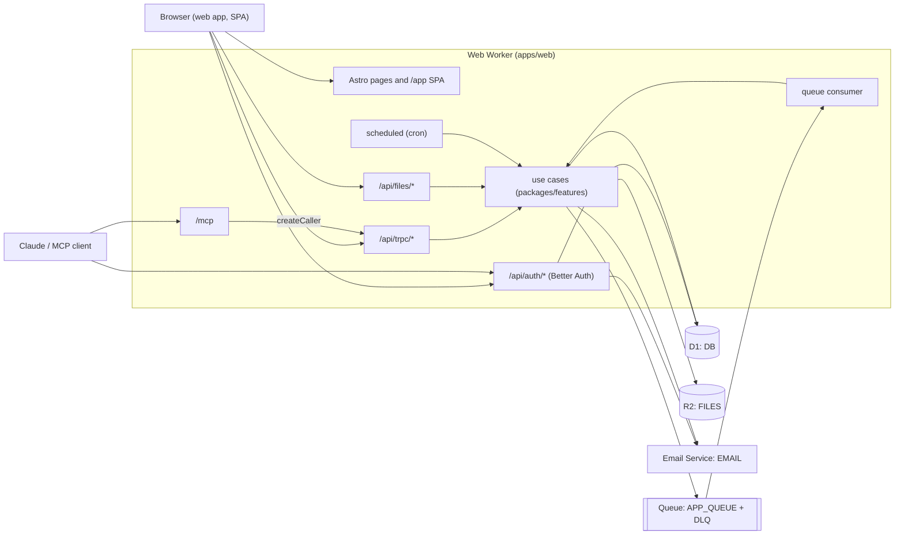

# Architecture Overview

How the starter is built and the rules every change follows: the parts, how a request moves through them, the environments, the architecture principles, and checklists for extending the system. It describes the target shape; the [Current state vs target](#current-state-vs-target) section lists where the code still differs. Use when you plan a change, review one, or need to know where something belongs.

## Parts

| Part            | Location                                         | What it is                                                                                                                                  |
| --------------- | ------------------------------------------------ | ------------------------------------------------------------------------------------------------------------------------------------------- |
| Web Worker      | [apps/web](../../apps/web/README.md)             | The one deployed Worker: Astro SSR pages, the React SPA under `/app/*`, Better Auth, tRPC, REST routes, `/mcp`, the queue consumer and cron |
| Worker entry    | `apps/web/src/worker.ts`                         | `fetch` (Astro handler), `queue` and `scheduled` handlers in one export                                                                     |
| Server adapters | `apps/web/src/server/`                           | Auth config, tRPC routers, MCP endpoint and tools, queue and cron handlers. Thin: they parse, authorize, call use cases, map errors         |
| HTTP routes     | `apps/web/src/pages/`                            | Astro pages (`.astro`) and endpoints (`.ts`): `/api/auth/*`, `/api/trpc/*`, `/api/files/*`, `/api/hello`, `/.well-known/*`, `/mcp`          |
| Features        | `packages/features/src/<feature>/`               | Vertical slices of server logic: pure `domain/`, one use case per file, the feature's Drizzle tables                                        |
| Platform        | `packages/features/src/platform/`                | Shared infrastructure the features receive as dependencies: D1 client, email service, queue producer, ids, clock                            |
| Migrations      | `packages/features/migrations/`                  | SQL generated by drizzle-kit, applied by Wrangler                                                                                           |
| UI library      | [packages/ui](../../packages/ui/README.md)       | Components on Radix + Tailwind tokens, brand in `src/brand/`; stories next to components                                                    |
| Storybook       | [apps/storybook](../../apps/storybook/README.md) | Storybook config; the build is served by the web Worker at `/_storybook/`                                                                   |
| Container demo  | [apps/container](../../apps/container/README.md) | A separate Worker with a Cloudflare Container, deployed on its own                                                                          |
| Setup scripts   | `scripts/`                                       | `setup:cloudflare`, `setup:secrets`, `setup:email`, `setup:github-runner`, `doctor`                                                         |
| CI and deploy   | `.github/workflows/`                             | `ci.yml` (lint, typecheck, test, migrations, build) and `deploy.yml` (manual, per environment)                                              |
| Agent skills    | `.claude/skills/`                                | `setup-auth`, `setup-d1`, `setup-email`                                                                                                     |

## Runtime



## Main flows

**Web request with a session.** `middleware.ts` resolves the Better Auth cookie into `Astro.locals.user`; anonymous `/app/*` requests redirect to `/sign-in`. The SPA calls `/api/trpc/*` with the `x-trpc-source: app` header (POSTs without it get 403). The tRPC context carries the user and the platform deps; a `protectedProcedure` refuses requests without a user. The procedure calls a use case.

**MCP request.** The client discovers the OAuth server through `/.well-known/*`, registers, sends the user through `/sign-in` and `/consent`, and gets a JWT bound to `<APP_URL>/mcp`. `/mcp` verifies the token with the in-process JWKS, reloads the user from D1, builds `appRouter.createCaller(context)` for that user and serves the tools. Each tool calls procedures in-process: same input schema, auth check and errors as the web app. Results wrap user data in `<untrusted-data>`.

**Queue message.** A use case sends a message (validated by the feature's zod schema) to `APP_QUEUE`. The `queue` handler parses each message, calls the use case for its `type`, acks it. Malformed messages are logged and acked; failures retry with backoff and land in the dead-letter queue after `max_retries`.

**Cron.** `triggers.crons` in `wrangler.jsonc` fires `scheduled`; the handler branches on `controller.cron` and calls one use case per schedule, passing `controller.scheduledTime` as the time.

## Environments and bindings

| Environment | Where it is configured                 | Built with                             | Secrets from                     |
| ----------- | -------------------------------------- | -------------------------------------- | -------------------------------- |
| local       | top level of `apps/web/wrangler.jsonc` | `bun run dev:web` (simulated bindings) | `apps/web/.dev.vars`             |
| develop     | top level of `apps/web/wrangler.jsonc` | `bun run deploy`                       | Worker secrets (`setup:secrets`) |
| staging     | `env.staging`                          | `CLOUDFLARE_ENV=staging` at build      | Worker secrets                   |
| production  | `env.production`                       | `CLOUDFLARE_ENV=production` at build   | Worker secrets                   |

Bindings of the web Worker, declared in every environment: `DB` (D1), `FILES` (R2), `EMAIL` (`send_email`), `APP_QUEUE` (queue producer) plus the queue consumer and its dead-letter queue, and `triggers.crons`. Vars: `APP_ENV`, `AUTH_EMAIL_PASSWORD`, `AUTH_REQUIRE_EMAIL_VERIFICATION`, `EMAIL_FROM_NAME`, `EMAIL_FROM` (written by `setup:email`). Secrets: `APP_URL`, `BETTER_AUTH_SECRET`, optional `GOOGLE_CLIENT_ID`/`GOOGLE_CLIENT_SECRET` and `R2_*`; the list with comments is in `apps/web/.dev.vars.example`. Setup steps: [how-to-setup-web-app.md](../guides/how-to-setup-web-app.md).

## Principles

Each principle is the rule that holds now; the linked ADR explains why. "(enforced in CI)" means a tool fails the build when the rule is broken; reviewers do not re-check those by hand when CI is green.

1. **One concept per file.** One use case, one component, one schema module per file. A small, tightly bound family (`Card` + `CardHeader`) may share a file. Architecture test: a use-case file exports exactly one runtime function (enforced in CI). [ADR 0010](../decisions/0010-feature-sliced-server-architecture.md)
2. **Barrels are the public API.** Every feature and folder has an `index.ts` that lists its exports explicitly. Code outside a feature imports only from its barrel, never a deep path. `export *` is allowed only in a package root re-exporting group barrels. Biome `noRestrictedImports` (deep feature imports), `noReExportAll` outside barrels, and dependency-cruiser's barrel-only rule (enforced in CI). [ADR 0010](../decisions/0010-feature-sliced-server-architecture.md)
3. **No import cycles.** Biome `noImportCycles` (enforced in CI). [ADR 0010](../decisions/0010-feature-sliced-server-architecture.md)
4. **Dependencies point inward: apps → features → domain.** `domain/` is pure: no I/O, no `fetch`, no `Date.now()` or argument-less `new Date()`, no `crypto.randomUUID()`, no env, no `console`. Time, ids and I/O are passed in. `packages/ui` and `packages/features` never import each other. Biome GritQL plugin in `lint/rules/*.grit` for domain purity, dependency-cruiser (`bun run deps:check`) for layer direction and ui↔features isolation (enforced in CI). [ADR 0010](../decisions/0010-feature-sliced-server-architecture.md)
5. **Server code is organised by feature; apps are thin adapters.** See [Feature layout](#feature-layout). tRPC procedures, MCP tools, HTTP routes, the queue consumer and cron handlers parse input, check auth, call a use case and map its typed errors. They hold no business logic and make no DB calls. Biome `noRestrictedImports` (no `drizzle-orm` in tRPC/MCP adapters) and a GritQL rule (no DB calls in adapters) (enforced in CI). [ADR 0010](../decisions/0010-feature-sliced-server-architecture.md)
6. **Every API is reachable through MCP.** Every tRPC procedure has an MCP tool or an exemption with a reason; every non-tRPC endpoint under `apps/web/src/pages` is listed in `NON_TRPC_ROUTES` with a reason. `apps/web/src/server/mcp/parity.test.ts` (enforced in CI). [ADR 0004](../decisions/0004-mcp-server-with-parity-test.md), [how-to-setup-mcp.md](../guides/how-to-setup-mcp.md)
7. **Bindings over keys.** Use Worker bindings (D1, R2, `send_email`, queues) where they exist; secrets live in `.dev.vars` and Worker secrets, never in code, config or command arguments. [ADR 0007](../decisions/0007-cloudflare-email-service.md), [ADR 0008](../decisions/0008-r2-binding-and-presigned-urls.md)
8. **`wrangler.jsonc` per environment.** Bindings and vars are not inherited by `env.*`; each environment declares all of them. The environment is chosen at build time with `CLOUDFLARE_ENV`. Architecture test: every binding exists in all environments (enforced in CI). [ADR 0006](../decisions/0006-wrangler-jsonc-env-at-build-time.md)
9. **Migrations are additive.** Add columns and tables; drop or rename only in a later change once no deployed code uses them. Generated by `bun run db:generate`, applied by Wrangler, never `drizzle-kit push` to a remote database. CI checks migrations are in sync with the schema and apply to an empty D1; an architecture test requires a `-- contract: <reason>` line in any migration with `DROP` or `RENAME` (enforced in CI). [ADR 0002](../decisions/0002-d1-and-drizzle.md)
10. **Exact dependency pins.** `bunfig.toml` sets `exact = true`; architecture test rejects `^`/`~` ranges (enforced in CI). [ADR 0009](../decisions/0009-exact-dependency-pins.md)
11. **One Worker** for HTTP, queue consumer and cron; split only for separate scaling, limits or deploys. [ADR 0005](../decisions/0005-one-worker-for-http-queue-and-cron.md)
12. **UI is token-only.** Components use theme tokens, never raw palette classes or hex values; brand lives in `packages/ui/src/brand/`. GritQL rule for tokens-only classes (enforced in CI). [ADR 0011](../decisions/0011-component-library-and-storybook.md), [packages/ui/CONVENTIONS.md](../../packages/ui/CONVENTIONS.md)

Other ADRs that shape the system: [0003 Better Auth](../decisions/0003-better-auth-in-the-worker.md). Full list: [decisions/README.md](../decisions/README.md).

## Feature layout

```
packages/features/src/
├── index.ts                     package root: re-exports each feature barrel
├── platform/                    shared infrastructure, passed to use cases as deps
│   ├── index.ts
│   ├── db.ts                    createDb(d1), Database type
│   ├── email.ts                 EmailService interface + Cloudflare implementation
│   ├── queue.ts                 queue producer
│   ├── ids.ts                   Ids interface (default: crypto.randomUUID)
│   └── clock.ts                 Clock interface (default: Date.now)
└── files/                       one feature (example)
    ├── index.ts                 public API: use cases, types, errors, schema tables
    ├── files.schema.ts          the feature's Drizzle tables
    ├── domain/
    │   ├── index.ts
    │   ├── file-key.ts          pure rule: buildFileKey(fileId, uploadedAt)
    │   ├── file-key.test.ts
    │   ├── upload-input.ts      zod schema + type
    │   └── errors.ts            FileNotFoundError, FileTooLargeError, ...
    ├── create-file-record.ts    one use case
    ├── create-file-record.integration.test.ts
    └── list-owned-files.ts
```

A use case is one exported function whose dependencies are explicit arguments:

```ts
export async function createFileRecord(
  deps: { readonly db: Database; readonly clock: Clock; readonly ids: Ids },
  input: CreateFileInput
): Promise<CreatedFile>;
```

Domain errors are typed classes in `domain/errors.ts`. Adapters map them to transport errors in one place (tRPC: `TRPCError` codes; HTTP routes: status codes); MCP gets the tRPC mapping for free because tools call procedures.

## Current state vs target

The code is not yet in the target shape; a follow-up PR restructures it. Until then, do not cite these as precedent:

| Area                 | Today                                                                                                                                | Target                                                                        |
| -------------------- | ------------------------------------------------------------------------------------------------------------------------------------ | ----------------------------------------------------------------------------- |
| Feature folders      | `packages/features/src/{db,email,queue,storage}` grouped by technology, one `index.ts` each                                          | `platform/` + one folder per feature with `domain/` and one use case per file |
| Tables               | `packages/features/src/db/schema/{auth,files}.ts`; `drizzle.config.ts` points at `src/db/schema/index.ts`                            | `<feature>/<feature>.schema.ts`                                               |
| Barrels              | `db/index.ts` uses `export * from "./schema"`; the package root re-exports `eq`, `and`, `desc` from drizzle                          | explicit barrel exports; no drizzle helpers outside features                  |
| Logic in adapters    | `trpc/router.ts` checks feature availability, builds queue payloads with `new Date()`; `queue.ts` and `cron.ts` contain the handling | use cases in `packages/features`, adapters only map                           |
| DB calls in adapters | `mcp/handler.ts` loads the user with `getDb(env).query.user`; `apps/web` depends on `drizzle-orm`                                    | a use case (or Better Auth API) loads the user                                |
| Enforcement          | Biome `recommended` preset only; no dependency-cruiser, GritQL rules or `test/architecture/`                                         | the rules marked "(enforced in CI)" above                                     |
| Tests                | router and MCP tests mock the DB; see [testing.md known gaps](testing.md#known-gaps)                                                 | the layers in [testing.md](testing.md)                                        |

Remove a row when the code matches the target.

## To change X, read Y

| To change                                   | Read                                                                                                                                                                                           |
| ------------------------------------------- | ---------------------------------------------------------------------------------------------------------------------------------------------------------------------------------------------- |
| Sign-in methods, auth tables, OAuth for MCP | [how-to-setup-auth.md](../guides/how-to-setup-auth.md), `apps/web/src/server/auth.ts`                                                                                                          |
| Database schema or migrations               | [how-to-setup-d1.md](../guides/how-to-setup-d1.md)                                                                                                                                             |
| File storage                                | [how-to-setup-r2.md](../guides/how-to-setup-r2.md)                                                                                                                                             |
| Email                                       | [how-to-setup-email.md](../guides/how-to-setup-email.md)                                                                                                                                       |
| MCP tools                                   | [how-to-setup-mcp.md](../guides/how-to-setup-mcp.md), `apps/web/src/server/mcp/tools.ts`                                                                                                       |
| Deploy, environments, queues, cron          | [how-to-setup-web-app.md](../guides/how-to-setup-web-app.md)                                                                                                                                   |
| CI or the deploy workflow                   | [how-to-setup-ci.md](../guides/how-to-setup-ci.md)                                                                                                                                             |
| UI components, brand, Storybook             | [packages/ui/CONVENTIONS.md](../../packages/ui/CONVENTIONS.md), [how-to-define-branding.md](../guides/how-to-define-branding.md), [how-to-use-storybook.md](../guides/how-to-use-storybook.md) |
| Tests                                       | [testing.md](testing.md)                                                                                                                                                                       |
| How work is planned, reviewed and shipped   | [processes/development.md](../processes/development.md), [processes/code-review.md](../processes/code-review.md)                                                                               |

## Extension checklists

Each list is the minimum; [testing.md](testing.md#change--required-test) names the tests and the [review checklist 5](../processes/code-review.md#5-documentation-and-retrievable-context) the docs.

**A feature**

- [ ] `packages/features/src/<feature>/` with `index.ts`, `domain/` (with its own `index.ts`), use-case files, `<feature>.schema.ts` if it has tables.
- [ ] Re-exported from `packages/features/src/index.ts`.
- [ ] No imports from another feature except through its barrel; none from `packages/ui`.
- [ ] An ADR if it introduces a pattern others will copy ([adrs.md](../processes/adrs.md)).

**A use case**

- [ ] One file, one exported function, deps (`db`, `bucket`, `clock`, `ids`, `email`, `queue`) as arguments.
- [ ] Rules it applies live in `domain/` with unit tests; it throws typed domain errors.
- [ ] Exported from the feature barrel; integration test if it touches D1, R2 or a queue.

**A D1 table or column**

- [ ] Drizzle table in `<feature>.schema.ts`; additive only.
- [ ] `bun run db:generate`; commit the SQL and `migrations/meta/`.
- [ ] `bun run db:migrate:local`; integration test for the queries that use it.
- [ ] Deploy order: migrations before code ([how-to-setup-d1.md](../guides/how-to-setup-d1.md)).

**A tRPC procedure and its MCP tool**

- [ ] Procedure in `apps/web/src/server/trpc/` with a zod input, `protectedProcedure` unless it is deliberately public, calling one use case and mapping its errors.
- [ ] MCP tool in `apps/web/src/server/mcp/tools.ts` (`direct(...)`), description written for the model; `outward: true` if it sends something outside the app.
- [ ] API test for the procedure, including the MCP call. `parity.test.ts` passes.

**An HTTP route (non-tRPC endpoint)**

- [ ] Only when tRPC cannot carry it (binary bodies, OAuth, discovery).
- [ ] Auth check and, for state-changing methods, an `Origin` check (Astro's `checkOrigin` is off for the OAuth token endpoint).
- [ ] Entry in `NON_TRPC_ROUTES` with a reason, or a tool that covers it.
- [ ] API test covering auth, origin and status codes.

**A binding**

- [ ] Declared in the top level, `env.staging` and `env.production` of `apps/web/wrangler.jsonc`.
- [ ] Typed in `apps/web/src/server/env.ts` (or `bun run cf-typegen`).
- [ ] Resource creation added to `scripts/setup-cloudflare.ts` and checked by `scripts/doctor.ts`.
- [ ] Passed to use cases as a dependency; integration test against the local binding.
- [ ] Setup steps in a guide.

**A queue message type**

- [ ] zod schema added to the discriminated union in the feature's domain; producer sends through the platform queue.
- [ ] Consumer branch calls a use case; malformed messages ack, failures retry.
- [ ] Integration test for producer and consumer.

**A cron job**

- [ ] Schedule in `triggers.crons` in all three environments.
- [ ] Branch on `controller.cron` in the scheduled handler, calling one use case with `scheduledTime` as its clock.
- [ ] Integration test of the use case; local trigger command in the guide.

**A UI component**

- [ ] `packages/ui/src/components/<kebab-name>.tsx`, exported from its group barrel in `src/exports/`.
- [ ] Stories next to it per [CONVENTIONS.md](../../packages/ui/CONVENTIONS.md), `play` functions for interactions.
- [ ] Tokens only; no data fetching or server imports.

**An env var or secret**

- [ ] Vars: in every environment of `wrangler.jsonc`. Secrets: in `apps/web/.dev.vars.example` with a comment, and in `scripts/setup-secrets.ts`.
- [ ] Parsed and validated in `apps/web/src/lib/config.ts`; `doctor` checks it if the app cannot boot without it.
- [ ] GitHub environment secret added to [how-to-setup-ci.md](../guides/how-to-setup-ci.md) if the deploy workflow needs it.
- [ ] Documented in the guide for the feature that uses it.
