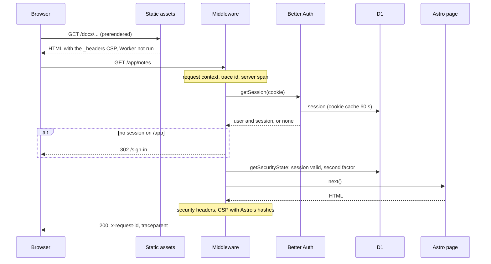
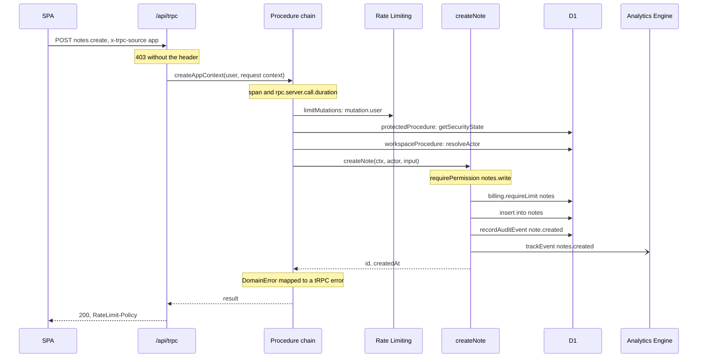
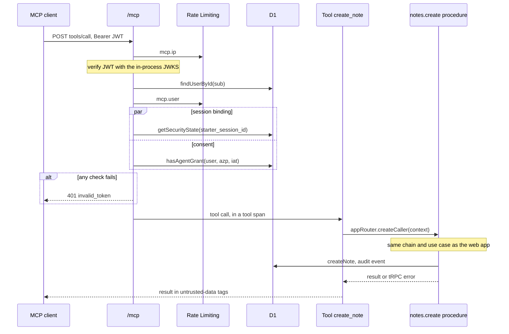
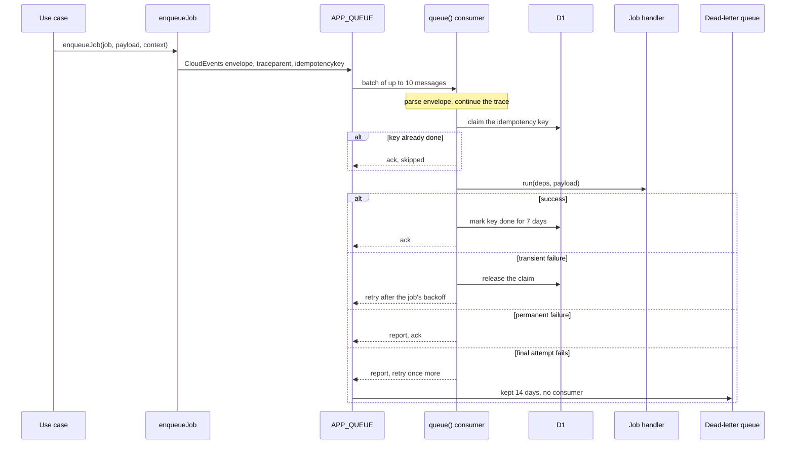
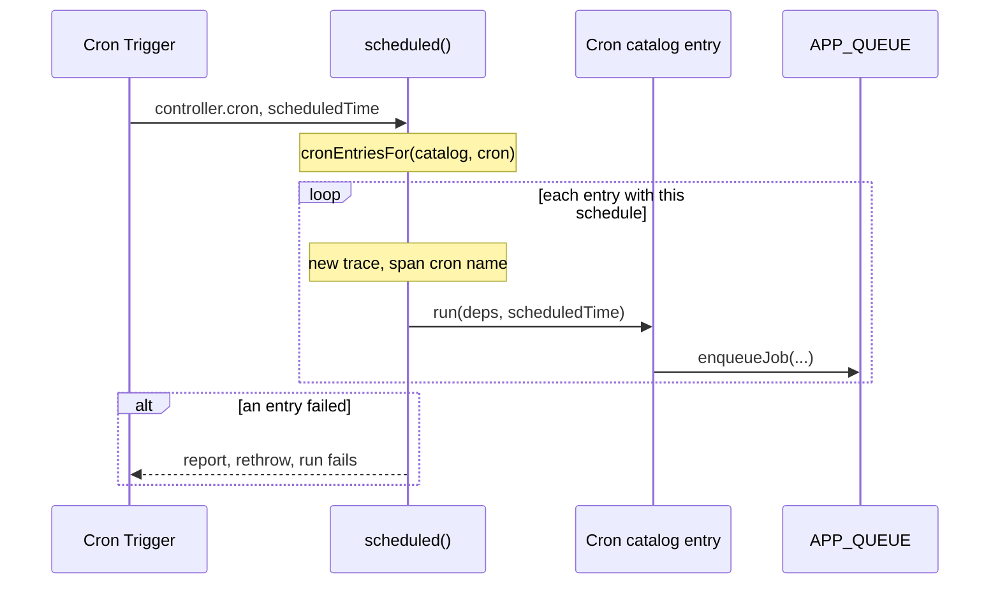
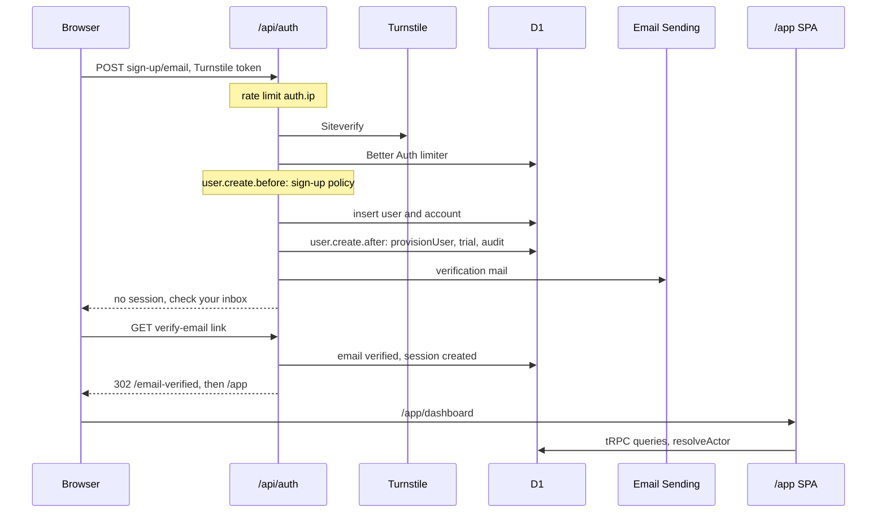

# Request lifecycles

How each kind of work moves through the Worker, step by step: a page, a tRPC mutation, an MCP tool call, a background job, a cron run and a sign-up. Use when you debug a request end to end, add a step to one of these paths, or need to know where a check runs.

Every diagram reads top to bottom; solid arrows are calls, dashed arrows answers. Each on-demand request first passes the middleware of [the page request](#a-page-request), so the later diagrams start after it.

## A page request

The middleware is [apps/web/src/server/app-middleware.ts](../../apps/web/src/server/app-middleware.ts); the request context, server span and `http.server.request.duration` come from `withRequestContext` in [http.ts](../../apps/web/src/server/http.ts), the headers from [security-headers.ts](../../apps/web/src/server/security-headers.ts). Auth endpoints, `/.well-known/*`, `/mcp` and `/api/csp-report` skip the cookie session. An unhandled error becomes a 500 Problem Details whose `reference` is the trace id. Guide: [how-to-configure-security-headers.md](../guides/how-to-configure-security-headers.md).

## A tRPC mutation

The chain is in [trpc/init.ts](../../apps/web/src/server/trpc/init.ts) (`publicProcedure` → `protectedProcedure` → `workspaceProcedure`), the procedure in [notes-router.ts](../../apps/web/src/server/trpc/notes-router.ts), the use case in [create-note.ts](../../packages/features/src/notes/create-note.ts). The rate limit runs before the auth checks, so anonymous callers are counted by IP. A refusal is a typed `DomainError` mapped once in [domain-errors.ts](../../apps/web/src/server/trpc/domain-errors.ts). Guides: [how-to-configure-workspaces.md](../guides/how-to-configure-workspaces.md), [how-to-use-the-audit-log.md](../guides/how-to-use-the-audit-log.md).

## An MCP tool call

The endpoint is [mcp/handler.ts](../../apps/web/src/server/mcp/handler.ts), the tools [mcp/tools.ts](../../apps/web/src/server/mcp/tools.ts) and [mcp/server.ts](../../apps/web/src/server/mcp/server.ts). The token comes from Better Auth's OAuth server (`/.well-known/*`, `/sign-in`, `/consent`); `mcp/parity.test.ts` keeps every procedure reachable as a tool. Guides: [how-to-setup-mcp.md](../guides/how-to-setup-mcp.md), [how-to-configure-account-security.md](../guides/how-to-configure-account-security.md).

## A background job

The producer side is [jobs/enqueue-job.ts](../../packages/features/src/jobs/enqueue-job.ts), the consumer [server/queue.ts](../../apps/web/src/server/queue.ts) with [jobs/run-job.ts](../../packages/features/src/jobs/run-job.ts), and every job type is in [job-catalog.ts](../../packages/features/src/job-catalog.ts). Retries are `max_retries` 5 in `wrangler.jsonc`; permanent means a malformed envelope, an unknown type, an invalid payload or a `DomainError` of kind invalid_input, forbidden or not_found. Guide: [how-to-add-background-jobs.md](../guides/how-to-add-background-jobs.md).

## A cron run

The handler is [server/cron.ts](../../apps/web/src/server/cron.ts), the entries [cron-catalog.ts](../../packages/features/src/cron-catalog.ts). Three schedules exist: hourly at minute 17 (`files.retry-cleanup`, `privacy.purge-exports`), daily at 03:17 UTC (audit, idempotency-key, notification and trash purges, trial expiry, storage reconciliation) and 08:00 UTC (`notifications.plan-digests`). `test/architecture/jobs.test.ts` keeps `triggers.crons` equal to the catalog's schedules. Guide: [how-to-add-background-jobs.md](../guides/how-to-add-background-jobs.md).

## Sign-up to the dashboard

The flow lives in [server/auth.ts](../../apps/web/src/server/auth.ts) (hooks), [workspaces/provision-user.ts](../../packages/features/src/workspaces/provision-user.ts) and the forms in `apps/web/src/components/auth/`. Without `AUTH_REQUIRE_EMAIL_VERIFICATION`, sign-up returns a session at once and the mail is still sent when email is configured. A failed provisioning is reported and does not fail the sign-up. Guides: [how-to-setup-auth.md](../guides/how-to-setup-auth.md), [how-to-configure-workspaces.md](../guides/how-to-configure-workspaces.md), [how-to-configure-abuse-protection.md](../guides/how-to-configure-abuse-protection.md).
