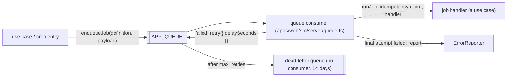

# How to add background jobs

How the web Worker runs work in the background: typed jobs on Cloudflare Queues, retries with backoff, idempotency keys, scheduled work through the cron catalog, what happens when a job keeps failing (error report, dead-letter queue), and when to use Cloudflare Workflows instead. Use when you add a job or a cron entry, debug a job that failed, inspect or replay the dead-letter queue, or decide between a job and a Workflow.

## How it fits together



| Piece            | Where                                                                         | What it does                                                                                                     |
| ---------------- | ----------------------------------------------------------------------------- | ---------------------------------------------------------------------------------------------------------------- |
| Job definition   | the feature's `domain/`, `defineJob` from `kernel/job.ts`                     | Type (`<feature>.<job>`), zod payload, backoff, optional idempotency key                                         |
| Enqueue          | `enqueueJob` in `packages/features/src/jobs/enqueue-job.ts`                   | Validates the payload, wraps it in the envelope, sends it through the JobQueue port. The only way onto the queue |
| Job catalog      | `packages/features/src/job-catalog.ts`                                        | Composition root: job type → handler (a use case). A job not registered here is acked and reported as unknown    |
| Consumer         | `apps/web/src/server/queue.ts`                                                | Parses the envelope, continues the producer's trace, runs the job, acks or retries each message                  |
| Idempotency keys | D1 table `job_idempotency_keys` (`packages/features/src/jobs/jobs.schema.ts`) | A completed key blocks duplicates for 7 days                                                                     |
| Cron catalog     | `packages/features/src/cron-catalog.ts`                                       | Composition root: `{ name, schedule, run }`; `scheduled` runs the entries whose schedule is the trigger's cron   |
| JobQueue port    | `platform/ports/job-queue.ts`, adapters `cloudflare/`, `memory/`              | `send(envelope, { delaySeconds })`; no noop adapter ([why](#why-there-is-no-noop-job-queue))                     |

Lint keeps the rest of the code off the queue: `lint/rules/no-direct-queue-send.grit` fails on `.APP_QUEUE` and on `.send(` called on anything named like a queue outside `packages/features/src/jobs/`, the Cloudflare JobQueue adapter and `apps/web/src/server/platform.ts` (which builds it).

## Add a job

1. Declare it in the owning feature's domain, e.g. `packages/features/src/billing/domain/send-invoice-job.ts`:

   ```ts
   export const sendInvoiceJob = defineJob({
     type: "billing.send-invoice",
     payload: z.object({ invoiceId: z.string() }),
     // No defaults: every job states its backoff.
     backoff: { initialDelaySeconds: 30, maxDelaySeconds: 3600, jitter: "full" },
     // Optional: run at most once per invoice (see Idempotency).
     idempotencyKey: (payload) => payload.invoiceId,
   });
   ```

   Keep the payload small (ids, not records: a message is at most 128 KB) and let the handler load current data. The user, workspace, time and trace travel in the envelope, not the payload.

2. Write the handler as a use case with explicit deps, e.g. `billing/send-invoice.ts`: `sendInvoice(deps: { db; email; logger }, payload, job)`. It gets `job.id`, `job.attempts`, `job.time` and `job.context` (the request context: trace, user, workspace). Throw a `DomainError` for failures no retry can fix (see [Retries](#retries-and-failures)).
3. Register it in `packages/features/src/job-catalog.ts`: `registerJob(sendInvoiceJob, sendInvoice)`. If the handler needs a dependency `JobDeps` lacks (`packages/features/src/jobs/run-job.ts`), add it there and in the consumer (`apps/web/src/server/queue.ts`).
4. Enqueue it from a use case:

   ```ts
   await enqueueJob(deps, sendInvoiceJob, { invoiceId }, { context, delaySeconds: 60 });
   ```

   `deps` is `{ jobQueue, clock, ids }` (the tRPC context and the cron deps have them); `context` is the caller's request context (`ctx.requestContext`, or the `context` a cron entry or job gets). `delaySeconds` is optional, 0 to 86400. In a `workspaceProcedure`, `ctx.requestContext` already carries the actor's workspace, so the envelope's `workspaceid` and the handler's `job.context.workspaceId` name the workspace the job acts in; a handler that needs permissions resolves the actor again from `job.context` (`resolveActor`), since the member's role may have changed while the job waited.
5. Tests ([testing.md](../architecture/testing.md#change--required-test)): a domain test of the payload schema and key; an integration test of the handler (real D1); a test that enqueues it with the memory JobQueue or the local `APP_QUEUE`. Consumer behaviour (retries, reports) is already covered by `apps/web/test/api/jobs.test.ts`.

## The envelope (CloudEvents)

Every message is a [CloudEvents 1.0](https://github.com/cloudevents/spec/blob/v1.0.2/cloudevents/spec.md) event in structured JSON mode (`kernel/job.ts`, schema in `jobs/domain/job-envelope.ts`):

```json
{
  "specversion": "1.0",
  "id": "6860a9e4-3734-44f1-b004-bceb5d5565da",
  "source": "/production/http",
  "type": "billing.send-invoice",
  "time": "2026-10-28T12:00:00.000Z",
  "datacontenttype": "application/json",
  "data": { "invoiceId": "inv-42" },
  "traceparent": "00-3b472a51d48a4ca0a9ba3771572f2e4f-6f2a1c9b0d4e8f71-01",
  "idempotencykey": "billing.send-invoice:inv-42",
  "userid": "user-1",
  "workspaceid": "ws-1"
}
```

- Core attributes: `id` (a UUID, the same on every redelivery), `source` (`/<environment>/<http|queue|cron>`, the kind of work that enqueued it), `type`, `time`. `type` is `<feature>.<job>` rather than the reverse-DNS prefix the spec recommends (a SHOULD): the queue is internal to one app.
- Extension attributes (lowercase alphanumeric, as the spec requires): `traceparent` ([W3C Trace Context](https://www.w3.org/TR/trace-context/) of the producer), `idempotencykey`, `userid`, `workspaceid`. Never the IP address.
- The consumer logs them as the OpenTelemetry attributes `cloudevents.event_id`, `cloudevents.event_type`, `cloudevents.event_source`.

## Retries and failures

One `max_retries` per consumer, the same in every environment of `wrangler.jsonc` (5), equal to `JOB_MAX_RETRIES` in `jobs/domain/retry-policy.ts` (an architecture test keeps them equal). A job is attempted at most 6 times. The consumer acks or retries every message explicitly:

| What happened                                                                                                           | The consumer                                                                                 | Reported?                             |
| ----------------------------------------------------------------------------------------------------------------------- | -------------------------------------------------------------------------------------------- | ------------------------------------- |
| Success, or a duplicate of a completed idempotency key                                                                  | acks; logs `job.completed` or `job.skipped` with `app.job.duration_ms`                       | no                                    |
| Malformed envelope, unknown type, invalid payload, or a `DomainError` of kind `invalid_input`, `forbidden`, `not_found` | acks (a retry cannot fix it)                                                                 | yes, `app.job.outcome: discarded`     |
| Any other error before the final attempt (including `conflict`: the key is held by another run)                         | `retry({ delaySeconds })` with the job's backoff; logs `job.retry` (WARN) with the exception | no                                    |
| Any error on the final attempt (attempt `max_retries + 1`)                                                              | reports, then retries once more: Queues moves the message to the dead-letter queue           | yes, `app.job.outcome: dead_lettered` |

Backoff (`jobs/domain/backoff.ts`): `initialDelaySeconds × 2^(attempt − 1)`, capped at `maxDelaySeconds` and 24 hours, then jittered (`full`: 1 s to the delay, `equal`: half the delay to the delay, `none`). The random source is injected, so tests are exact. `retry_delay` in `wrangler.jsonc` only applies if a whole batch fails, which the consumer prevents by catching per message.

The report (`error.captured`, [how-to-setup-error-reporting.md](how-to-setup-error-reporting.md)) carries the trace id (the reference), `user.id`, `app.workspace.id`, `cloudevents.event_id` (job id), `cloudevents.event_type` (job type), `messaging.message.id`, `app.job.attempts`, `app.job.max_attempts` and the exception. There is no job history table: Workers Logs and the dead-letter queue are the record.

## Idempotency

Queues delivers at least once, and a retry runs the whole handler again. A job whose side effect must not repeat (charge, email, external call) defines `idempotencyKey`; `enqueueJob` stores `<type>:<key>` in the envelope, and `runJob` (`jobs/run-job.ts`) uses the D1 table `job_idempotency_keys` (`key` primary key, `job_type`, `job_id`, `status` in_progress | done, `locked_until`, `expires_at`, indexed on `expires_at`):

- Before the handler runs it claims the key with `INSERT … ON CONFLICT DO UPDATE … WHERE`: a new key, an expired one, an in-progress one whose 15-minute lock ran out (the run that held it died), or one the same job id held on an earlier delivery can be claimed.
- A key that is `done` makes the job `skipped` (acked). A key another run holds throws `JobLockedError` (kind `conflict`): retried with backoff.
- On success the key becomes `done` for 7 days; on failure the claim is released so the retry can take it.
- This is at least once with deduplication, not exactly once: a delivery that dies after the side effect but before the key is marked `done` (or whose `done` update fails) is run again by its redelivery, which takes over its own claim at once. A handler that calls an outside service should pass the key on when the service accepts one (payment and email APIs usually do).
- The cron entry `jobs.purge-idempotency-keys` (daily, 03:17 UTC) enqueues the job of the same name, which deletes expired keys.

A job without a key is not deduplicated: make its handler safe to run twice (upserts, conditional updates), or give it a key.

## Add a cron entry

1. Add `{ name, schedule, run }` to `packages/features/src/cron-catalog.ts`. `run(deps, { scheduledTime, context })` should only enqueue jobs (fan out); the queue then retries each piece on its own. `scheduledTime` is the run's "now"; pass it in the payload when the job must compute the same thing on every retry (`audit.purge-events` sends it as `asOf`, so a retry purges against the same cutoff). Today the catalog has `audit.purge-events` and `jobs.purge-idempotency-keys`, both on the daily `17 3 * * *`.
2. Add the schedule to `triggers.crons` in the top level, `env.staging` and `env.production` of `apps/web/wrangler.jsonc` (UTC). Several entries may share a schedule; `scheduled` runs every entry whose schedule equals `controller.cron` exactly, so write it identically in both places. The architecture test `test/architecture/jobs.test.ts` fails when `triggers.crons` and the catalog differ, or when an entry's name appears in no test.
3. Test it by name in `apps/web/src/server/cron.test.ts` (what it enqueues).

A failing entry is reported (`app.cron.name`) and the other entries of the trigger still run; the run then fails, so it shows as failed under the Worker's Cron Events. A trigger with no entry is reported too. Cron changes take up to 15 minutes to reach Cloudflare's network after a deploy.

## Run it locally

`bun run dev:web` runs the producer, consumer and cron in one dev server (Miniflare queues, local D1; migrate first with `bun run db:migrate:local`).

- Enqueue: `/app/queue-demo` (tRPC `queue.enqueueHello`, MCP tool `enqueue_hello`) enqueues `greetings.hello`; the dev output shows a `greetings.hello` record, then `job.completed`, with the `trace_id` of the request.
- Trigger a cron schedule (URL-encode spaces as `+`):

  ```bash
  curl "http://localhost:4321/cdn-cgi/local/scheduled?cron=17+3+*+*+*"
  # optional: &time=<epoch ms> sets controller.scheduledTime
  ```

  It answers `ok` (or `exception` when an entry failed); the dev output shows `cron.completed` and, a few seconds later (the batch timeout), the enqueued job's `job.completed` in the same trace.

- Miniflare retries and dead-letters locally like Cloudflare does (`max_retries`, `retry({ delaySeconds })`); local dead-lettered messages go to the local `-dlq` queue and are not kept across restarts.

## Dead-letter queue

Each consumer's `dead_letter_queue` (`cloudflare-starter-<env>-dlq`) has **no consumer**: failed jobs wait there to be looked at, and nothing retries them automatically. A dead-letter queue is a normal queue, so its messages are kept for the queue's message retention: `bun run setup:cloudflare` creates (or updates) every dead-letter queue with `--message-retention-period-secs 1209600`, the maximum, 14 days (`DLQ_MESSAGE_RETENTION_SECONDS` in `scripts/queue-plan.ts`). Retention is a queue setting, not part of `wrangler.jsonc`; the architecture test checks that the setup script applies it to every environment's dead-letter queue. Without the script the retention is Cloudflare's default, 4 days; on Workers Free it is fixed at 24 hours: the script then warns, keeps the queue with its fixed retention and goes on with the other resources. A queue named in `dead_letter_queue` that does not exist is created by Cloudflare on deploy with the default retention, so run `setup:cloudflare` first.

To change the retention of an existing queue by hand: `cd apps/web && bunx wrangler queues update cloudflare-starter-production-dlq --message-retention-period-secs 1209600`.

### Inspect and replay

1. Find the failure: the `error.captured` record with `app.job.outcome = dead_lettered` in Workers Logs gives the trace id, job id and type ([how-to-setup-error-reporting.md](how-to-setup-error-reporting.md#finding-a-report)). Filter `trace_id = <id>` for every `job.retry` before it.
2. Look at the message: Cloudflare dashboard → Storage & Databases → Queues → `cloudflare-starter-<env>-dlq` → Messages → List. Previewing does not remove or reorder messages. The body is the JSON envelope.
3. Fix the cause and deploy.
4. Replay: send the envelope (same `id`, `traceparent` and `idempotencykey`, so the run continues the trace and stays deduplicated) back to the main queue, e.g. paste it in the dashboard's Send message form for `cloudflare-starter-<env>`, or with the HTTP API (`POST /accounts/{account_id}/queues/{queue_id}/messages`). Then remove it from the dead-letter queue: select it in the list and choose Acknowledge messages.
5. For many messages, a project can add a short-lived consumer for the dead-letter queue (or an HTTP pull consumer) that re-sends to the main queue; the starter ships none on purpose, so nothing drains the queue unseen.

### How long you can look back

| Where                           | Kept                                                                                      |
| ------------------------------- | ----------------------------------------------------------------------------------------- |
| Dead-letter queue messages      | 14 days (set by `setup:cloudflare`; 24 hours on Workers Free)                             |
| Workers Logs (reports, `job.*`) | 3 days on Workers Free, 7 days on Workers Paid                                            |
| Queues metrics (dashboard)      | Backlog, message operations, consumer concurrency per queue; for trends, not single jobs  |
| `messaging.process.duration`    | 3 months in Analytics Engine: duration and count per job type and outcome (`METRICS`)     |
| Span records (`trace.span`)     | With Workers Logs: one `process <queue>` span per message, on the job's trace (`TRACING`) |

A project that needs longer history exports logs: Workers Logpush or OpenTelemetry export to a backend with its own retention ([how-to-setup-logging.md](how-to-setup-logging.md)). Job and cron metrics and spans: [how-to-setup-metrics-and-tracing.md](how-to-setup-metrics-and-tracing.md#what-is-measured).

## Why there is no noop job queue

Every other port has a `noop` adapter as its explicit "off". The JobQueue port does not: a queue that silently drops jobs loses work (an unsent email, an unbilled invoice) without a trace. `buildPlatform` fails with a ConfigError naming `APP_QUEUE` when the binding is missing, and tests use the memory adapter (`createMemoryJobQueue`), which records what was sent.

## Jobs or Workflows

A job is one retryable step, finished within one consumer invocation (15 minutes of wall time, 30 s CPU by default). Use [Cloudflare Workflows](https://developers.cloudflare.com/workflows/) instead when the work is:

- several steps whose results must survive a failure between them (each `step.do` is retried and remembered on its own);
- waiting longer than a queue delay allows (more than 24 hours): `step.sleep` up to 365 days;
- waiting for an outside event or a person (`step.waitForEvent`, e.g. an approval);
- longer than 15 minutes in total.

A job can start a Workflow instance; the starter does not include one. Adding it is a new binding ([overview.md](../architecture/overview.md#extension-checklists)) and an ADR, since it is a second pattern for background work.

## Common problems

### A job is acked but nothing happened

Look for `error.captured` with `app.job.outcome = discarded`: the envelope was malformed, the type is not in the job catalog (registered in `job-catalog.ts`?), the payload did not match, or the handler threw a permanent `DomainError`.

### The same job ran twice

Queues delivers at least once. Give the job an `idempotencyKey`, or make the handler safe to repeat.

### `Wrangler refuses to deploy`: queue not found

The queue must exist for the environment before the first deploy: `bun run setup:cloudflare --env <env>`.

### The cron run fails with "No cron catalog entry has the schedule"

`triggers.crons` in `wrangler.jsonc` lists a schedule the cron catalog does not have (or writes it differently). The architecture test catches this before deploy.
