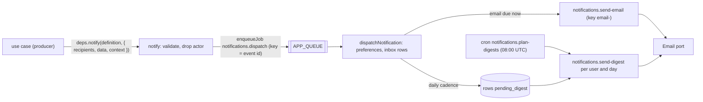

# How to send notifications

How a feature tells users that something happened: the in-app inbox (bell, inbox page), email (one mail at once or a daily digest), per-user preferences, RFC 8058 one-click unsubscribe, security notices, and retention. Use when you add a notification type, send one from a use case, change what users get by default, debug a missing mail or inbox entry, or change digest timing or retention.

## How it fits together



| Piece                 | Where                                                                                                                   | What it does                                                                                                                                         |
| --------------------- | ----------------------------------------------------------------------------------------------------------------------- | ---------------------------------------------------------------------------------------------------------------------------------------------------- |
| Definition            | the owning feature's `domain/`, `defineNotification` from `kernel/notification.ts`                                      | Type (`<feature>.<name>`), label, zod data, `defaultChannels`, `securityCritical`, `render(data, { appUrl })` → in-app and email wording             |
| Catalog               | `packages/features/src/notification-catalog.ts`                                                                         | Composition root: every type, in the order of the preferences screen. A type not listed here fails dispatch permanently                              |
| Send                  | `notify` in `packages/features/src/notifications/notify.ts`, given to use cases as `deps.notify` (kernel type `Notify`) | Validates the data, drops the actor from the recipients (not for security notices), enqueues one `notifications.dispatch` job. Writes nothing itself |
| Dispatch              | `dispatchNotification` (job `notifications.dispatch`)                                                                   | Per recipient: channels from the type's defaults and the user's overrides, an inbox row, an email job or a digest mark                               |
| Tables                | `notifications`, `notification_preferences`, `notification_settings` (`notifications.schema.ts`)                        | Inbox rows with their email state; overrides only (a missing row is the default); the email cadence                                                  |
| Inbox and preferences | tRPC `notifications.*`, MCP tools, `/app/notifications`, `/app/notifications/preferences`                               | List, unread count, mark read, archive, preferences; the bell in the top bar                                                                         |
| Unsubscribe           | `POST /api/notifications/unsubscribe?t=…`, page `/unsubscribe`                                                          | RFC 8058 one-click: signed token, no session                                                                                                         |

`notify` reaches use cases as a dependency because the features that send notifications (workspaces, accounts) are below the notifications feature (its tables reference theirs), so they cannot import it. The app binds it: `ctx.notify` in tRPC (`apps/web/src/server/trpc/context.ts`), `notifierFor(env)` in the Better Auth hooks (`apps/web/src/server/auth-audit.ts`).

## Add a notification type

1. Declare it in the owning feature's domain, e.g. `packages/features/src/billing/domain/notifications.ts`:

   ```ts
   export const invoicePaidNotification = defineNotification({
     type: "billing.invoice-paid",
     label: "An invoice of your workspace is paid",
     data: z.object({ invoiceId: z.string(), amount: z.string(), workspaceName: z.string() }).strict(),
     // No defaults: state both channels.
     defaultChannels: { inApp: true, email: true },
     securityCritical: false,
     render: (data, { appUrl }) => ({
       inApp: { title: `Invoice ${data.invoiceId} paid`, body: `${data.amount} for ${data.workspaceName}.`, href: "/app/billing" },
       email: {
         subject: `Invoice ${data.invoiceId} paid`,
         text: `${data.amount} for ${data.workspaceName}: ${appUrl}/app/billing`,
         // The kernel's `html` tag escapes every value: user data cannot inject markup.
         html: html`<p><strong>${data.amount}</strong> for ${data.workspaceName}.</p>`.value,
       },
     }),
   });
   ```

   Keep data small and copy what the wording needs (names, ids): it is stored on the row and rendered whenever the inbox is read, so text changes apply to old entries too. No secrets or tokens in data.

2. Add it to `packages/features/src/notification-catalog.ts`.
3. Send it from the use case, after the change succeeded (next to `recordAuditEvent`):

   ```ts
   await deps.notify(invoicePaidNotification, {
     recipients: ownerIds,
     data: { invoiceId, amount, workspaceName },
     context: { workspaceId: actor.workspaceId, requestContext: deps.requestContext },
   });
   ```

   Add `readonly notify: Notify` to the use case's deps; tRPC procedures pass `ctx`, which has it. At most 500 recipients per call (`MAX_RECIPIENTS`); split larger fan-outs. `workspaceId` makes the rows go with the workspace when it is deleted.
4. Tests ([testing.md](../architecture/testing.md#change--required-test)): a domain test of `render` (including that user data is escaped in `html`) and of the data schema; in the producer's integration test, assert the event with `notificationsSent(deps.jobQueue)` from `packages/features/test/fixtures.ts`. Dispatch, mail and digest are covered once in `packages/features/src/notifications/`.

The review checklist asks for it: a user-facing event (someone joined, a role changed, an invoice failed) uses `notify`, not a hand-written mail ([code-review.md](../processes/code-review.md#1-server-side-architecture)).

## Channels, preferences and cadence

- **Defaults** come from `defaultChannels`. A user's choice is stored in `notification_preferences` only where it differs from the default (`storedOverride`); turning a switch back removes the row.
- **Email cadence** (`notification_settings.email_cadence`): `instant` (default for a user without a row) sends each mail at once; `daily` marks rows `pending_digest` for the digest.
- **Security notices** (`securityCritical: true`, today `auth.password-changed` and `auth.new-sign-in`): always in-app and email, always at once (never in a digest), no unsubscribe link or header, locked in the preferences (an update that names them is refused with `NOTIFICATION_PREFERENCE_LOCKED`), and the actor is not dropped (they are who to warn).
- **Email off for the deployment** (no `EMAIL` binding or no `EMAIL_FROM`: the Email port's noop adapter): rows are still written for the inbox; their email state is `skipped` and the dispatcher logs `notifications.email_skipped` (warn). The preferences screen says email is not set up.

Email states of a row: `none` (channel off), `pending` (a `notifications.send-email` job is due), `pending_digest`, `sent`, `skipped`.

## Producers today

| Type                       | Sent by                                                                                                              | To                                                                           |
| -------------------------- | -------------------------------------------------------------------------------------------------------------------- | ---------------------------------------------------------------------------- |
| `workspaces.member-joined` | `acceptInvitation`                                                                                                   | the workspace's members who can `members.manage`, not the joiner             |
| `workspaces.role-changed`  | `changeMemberRole` (when the role changes), `transferOwnership` (the new owner)                                      | the member whose role changed, unless they made the change                   |
| `auth.password-changed`    | Better Auth hooks in `apps/web/src/server/auth-audit.ts`: `/change-password` success, `onPasswordReset`              | the user                                                                     |
| `auth.new-sign-in`         | the session hook after a password or social sign-in (not sign-up, not email verification), through `notifyNewSignIn` | the user, when no other live session has the same user agent (`isNewSignIn`) |

A failure to notify from the Better Auth hooks is reported and never fails the sign-in or password change.

## Email: headers and unsubscribe

Each mail is the definition's `render(...).email` in the mail layout (`notificationMail`, `notifications/domain/email-layout.ts`): the body, then a footer with the notification settings link and, unless security-critical, an unsubscribe link. The same mails carry the [RFC 8058](https://www.rfc-editor.org/rfc/rfc8058) headers:

```
List-Unsubscribe: <https://app.example.com/api/notifications/unsubscribe?t=<token>>
List-Unsubscribe-Post: List-Unsubscribe=One-Click
```

- **Token.** `<payload>.<signature>` (base64url): payload `{ u: userId, t: type }` (`*` for a digest: every type that can be turned off), signature HMAC-SHA256 with a key derived from `BETTER_AUTH_SECRET` by HKDF-SHA256 (info `notifications.unsubscribe`). No expiry: a link in an old mail keeps working. **Rotating `BETTER_AUTH_SECRET` invalidates every unsubscribe link already sent** (and signs everyone out); users can still change their settings in the app.
- **POST** (what Gmail, Apple Mail and others send, and what the `/unsubscribe` page's button sends) with the body `List-Unsubscribe=One-Click` turns email off for that type at once, answers 200 JSON, and records `notifications.unsubscribed`. Any other body is 400 (Problem Details); a bad token is 400 `INVALID_UNSUBSCRIBE_TOKEN`. There is no Origin check on purpose (mail providers post from their servers, and the route uses no cookies); the reason is in the route.
- **GET** never unsubscribes (link scanners and previews open links): it redirects (303) to `/unsubscribe?t=…`, which shows what the link is for and a button.
- **Limits.** The POST is limited per IP by `notifications.unsubscribe` (20 a minute, binding `RL_UNSUBSCRIBE`); the page by `token.lookup` ([how-to-configure-abuse-protection.md](how-to-configure-abuse-protection.md)).

See the mails locally: with `EMAIL_FROM` set in `.dev.vars`, `wrangler dev` writes each message (text and HTML, headers in the log line) under `apps/web/.wrangler/tmp/email/` ([how-to-setup-email.md](how-to-setup-email.md)).

## Digest

The cron entry `notifications.plan-digests` runs daily at `DIGEST_HOUR_UTC` (08:00 UTC, schedule `0 8 * * *` in `triggers.crons` of every environment). It enqueues `notifications.plan-digests` with the run's time as `asOf`; that job enqueues one `notifications.send-digest` per user with `pending_digest` rows created up to `asOf`, keyed `digest-<user>-<UTC date>`, so a retried plan never mails twice in a day. Each digest lists up to 90 rows grouped by type and marks them `sent`. To change the hour, change `DIGEST_HOUR_UTC` and the schedule in `apps/web/wrangler.jsonc` (all three environments; `test/architecture/jobs.test.ts` compares them).

Run it locally: `curl "http://localhost:<port>/cdn-cgi/handler/scheduled?cron=0+8+*+*+*"` with `bun run dev:web` running.

## Retention

The daily cron entry `notifications.purge` (`17 3 * * *`, with the other purges) deletes read or archived rows older than `READ_RETENTION_DAYS` (90) and any row older than `UNREAD_RETENTION_DAYS` (365) (`notifications/domain/retention.ts`). Rows also go with their user (account deletion) and their workspace. Preferences and settings stay until the user is deleted.

## Audit

`notifications` is an audited feature. Recorded: `notifications.preferences_changed` (how many switches, the new cadence) and `notifications.unsubscribed` (the type). Not recorded, with the reason in `AUDIT_EXEMPT` (`test/architecture/audit-coverage.test.ts`): reading and archiving (the recipient's own inbox state), dispatch and mail delivery (the producing use case records the event itself), and the retention purge.

## The inbox in the app

- `<NotificationBell>` (badge, popover inbox) sits in the top bar (`AppLayout`, `apps/web/src/components/app/notifications/`); "View all" opens `/app/notifications`, "Settings" `/app/notifications/preferences`. Components: `NotificationBell`, `NotificationInbox`, `NotificationList`, `NotificationPreferences`, `UnsubscribeCard` in `packages/ui` (Storybook: Patterns).
- The unread count loads on page load, when the window regains focus or becomes visible, and every 60 s while it is visible (`useUnreadCount`). It is capped at 100 (the badge shows "99+").
- Agents use the MCP tools `list_notifications` (with the unread count), `mark_notifications_read`, `archive_notifications`, `get_notification_preferences`, `update_notification_preferences`.

### Realtime

Polling keeps the starter simple and costs one small indexed query per open tab a minute. For instant badges, add a Durable Object per user that holds WebSocket connections (hibernation API): the dispatcher calls it after writing rows, and the bell subscribes instead of polling. Nothing else changes: the inbox stays in D1.

## Common problems

| Symptom                           | Check                                                                                                                                                                               |
| --------------------------------- | ----------------------------------------------------------------------------------------------------------------------------------------------------------------------------------- |
| No inbox entry                    | The actor is not notified about their own action; the recipient may have turned the in-app channel off; look for `notifications.dispatch` in the logs (`job.completed` or a report) |
| Entry but no mail                 | The row's `email_state`: `none` (turned off), `pending_digest` (daily cadence), `skipped` (email off for the deployment)                                                            |
| Dispatch reported as unknown type | The type is not in `notification-catalog.ts`                                                                                                                                        |
| Unsubscribe link says "not valid" | `BETTER_AUTH_SECRET` changed since the mail was sent, or the link was cut off by the mail client                                                                                    |
| 429 on unsubscribe                | `notifications.unsubscribe` (20 a minute per IP)                                                                                                                                    |
