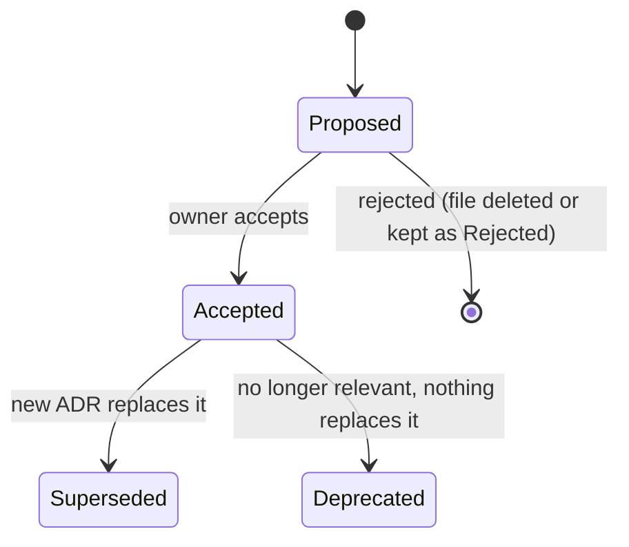

# Architecture Decision Records

How this repository records significant decisions as ADRs: when one is needed, its format and statuses, how it relates to the architecture docs, and how agents propose one. Use when a change makes or reverses a decision others will build on, or when you review a PR that might need an ADR.

The practice follows Michael Nygard, "Documenting Architecture Decisions" (2011, <https://cognitect.com/blog/2011/11/15/documenting-architecture-decisions>), with guidance from <https://adr.github.io> and <https://github.com/joelparkerhenderson/architecture-decision-record>.

## When to write one

Write an ADR when a decision is any of:

- hard or expensive to reverse (data store, auth provider, deployment shape);
- cross-cutting (affects several features or both apps and packages);
- changes how others build (a pattern to copy, a rule to follow);
- contested, or picks between real alternatives that someone will later ask about.

Do not write one for routine choices: a library within an already chosen approach, naming, a refactor that keeps the rules, a bug fix.

## Format

One decision per ADR, about one page. Copy [decisions/0000-template.md](../decisions/0000-template.md).

| Section                 | Content                                                                     |
| ----------------------- | --------------------------------------------------------------------------- |
| Title                   | `NNNN. Decision as a short phrase` (what was decided, not the problem)      |
| Status                  | `Proposed`, `Accepted`, `Superseded by NNNN`, or `Deprecated`               |
| Date                    | The date of the current status (`YYYY-MM-DD`)                               |
| Context                 | The forces: requirements, constraints, facts that made a decision necessary |
| Decision                | What we do, in active voice ("We use …")                                    |
| Consequences            | Positive and negative, both stated; what becomes easier and harder          |
| Alternatives considered | Each real option and why it was rejected                                    |

## Statuses and immutability

- Once **Accepted**, an ADR is not edited except for typos and broken links. To change the decision, write a new ADR and set the old one's status to `Superseded by NNNN` (the only other permitted edit).
- A rejected proposal may be kept with status `Rejected` when the reasoning is worth keeping; otherwise delete it.

## Files and numbering

- `docs/decisions/NNNN-kebab-title.md`, four-digit number, next free number, never reused.
- Every ADR is listed in [docs/decisions/README.md](../decisions/README.md) with its status.

## ADRs and architecture docs

- The architecture doc states the **current rule**; the ADR records **why** and the history. Do not restate the ADR in the architecture doc or the other way round.
- The architecture doc links the ADR from the principle or section it shapes.
- When an ADR is superseded, update the architecture doc's rule and link in the same PR.

## When it is written

In the PR that implements the decision, or before it with status `Proposed` when the decision needs agreement first. The PR template asks for the ADR link or "not needed because …".

## Agents

Agents propose ADRs with status `Proposed` and say so in the PR. Only the owner moves an ADR to `Accepted`. An agent never edits an accepted ADR's content; it proposes a superseding one.

## Review

Reviewers check that a decision meeting the criteria above has an ADR, that it is listed in the index, and that the architecture doc states the current rule ([code-review.md](code-review.md), checklist 5). A missing ADR for such a decision is a finding.
