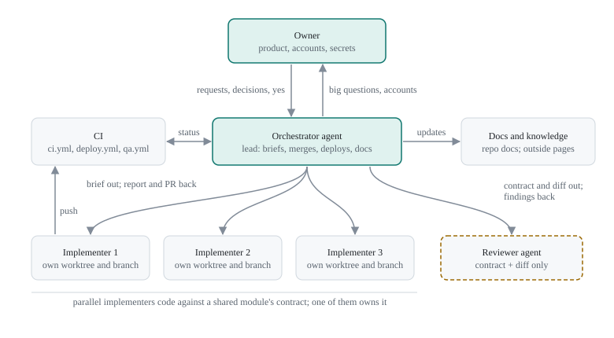

# Agentic workflow

How this repository is built by coding agents working as a team: an orchestrator agent that leads, implementer subagents that each build one item in their own worktree, an independent reviewer subagent, CI, and the owner who decides. It is the recommended way to work on the starter and on a project started from it. It wraps the [development loop](development.md) and [code review](code-review.md) every change follows; it does not replace them. Use when you lead agents on this repository, write a brief for a subagent, run several agents in parallel, or check what an agent may do without asking.

The starter is agent-native in two ways. The app lets agents act on it, through MCP with OAuth ([how-to-setup-mcp.md](../guides/how-to-setup-mcp.md)). The repository is built for coding agents to develop it: this page, the [processes](../README.md#processes), the [skills and subagents](agent-skills.md) in `.claude/`, and the architecture tests and CI that catch what an agent misses.

## Roles



| Role                 | Who                                                              | Does                                                                                                                                                                                                                | Never                                                        |
| -------------------- | ---------------------------------------------------------------- | ------------------------------------------------------------------------------------------------------------------------------------------------------------------------------------------------------------------- | ------------------------------------------------------------ |
| Owner                | The person the work is for                                       | Decides product and scope, answers the big questions, says yes to ship, changes accounts and secrets or approves each change, accepts Medium and Low findings, accepts ADRs                                         | Gets asked about what the docs already settle                |
| Orchestrator         | One agent session acting as lead or PM                           | Talks to the owner, makes the small product decisions, writes briefs, starts implementers, reads their reports, checks CI and attribution, merges, deploys on the owner's yes, keeps the docs and knowledge current | Merges with CI red; asks the owner what it can decide itself |
| Implementer subagent | One agent per item, in its own git worktree and branch           | Follows the brief and the [development loop](development.md#the-loop), runs the checks, captures evidence, opens one PR, reports back                                                                               | Merges, deploys, changes accounts, works outside its brief   |
| Reviewer subagent    | [`.claude/agents/reviewer.md`](../../.claude/agents/reviewer.md) | Reviews a risky diff against [code-review.md](code-review.md), seeing only the task contract and the diff                                                                                                           | Edits files, sees the conversation                           |
| CI                   | [`.github/workflows/`](../../.github/workflows/)                 | `ci.yml` on every pull request and push to `main`; `deploy.yml` by hand, then its smoke suite; `qa.yml` after a production deploy and nightly ([how-to-setup-ci.md](../guides/how-to-setup-ci.md))                  | Deploys on its own: a deploy only starts by hand             |

## The lifecycle of a change


| Step             | Who                   | What happens                                                                                                                                                                                                        | Defined in                                                                           |
| ---------------- | --------------------- | ------------------------------------------------------------------------------------------------------------------------------------------------------------------------------------------------------------------- | ------------------------------------------------------------------------------------ |
| 1. Request       | Owner                 | Says what they want. The orchestrator asks only what changes the implementation, three to five questions at a time, each with a recommended answer                                                                  | [development.md, Plan](development.md#1-plan)                                        |
| 2. Brief         | Orchestrator          | Writes the brief: goal, decisions, constraints, done, checks, rules ([template](#writing-a-brief)). It is the task contract the reviewer gets                                                                       | [Plan schema](development.md#plan-schema)                                            |
| 3. Worktree      | Orchestrator          | Starts an implementer in its own worktree (under `.claude/worktrees/`, gitignored) on a branch from the latest `origin/main`                                                                                        | [Parallel work](#parallel-work)                                                      |
| 4. Implement     | Implementer           | Code, the tests [testing.md](../architecture/testing.md) requires, docs and the changelog line in the same branch. Stops at the unexpected-problem gate                                                             | [development.md](development.md#2-implement)                                         |
| 5. Checks        | Implementer           | `bun run verify`, then what the change touches: `build`, `budget`, `test:components`, `test:e2e`, `test:e2e:build`. Every command and result goes into the PR                                                       | [development.md, Verify](development.md#3-verify)                                    |
| 6. Evidence      | Implementer           | Screenshots and recordings, pushed to the orphan `pr-evidence` branch under `pr-<number>/` and linked from the PR, never committed to a code branch                                                                 | [development.md, Evidence](development.md#4-evidence)                                |
| 7. Review        | Implementer, reviewer | Self-review always. A risky change also gets the `reviewer` subagent with the brief and the diff. Critical, High and Medium findings are fixed; Low ones are listed for the owner                                   | [code-review.md](code-review.md)                                                     |
| 8. Pull request  | Implementer           | One PR per item, from [the template](../../.github/pull_request_template.md): verification record, evidence, docs audit, findings and how each was handled. Then a short report to the orchestrator                 | [development.md, Ship](development.md#7-ship)                                        |
| 9. CI and report | Orchestrator          | Reads the report and the diff, waits for CI to pass (its `lint` job also fails on an agent credited in a commit), sends fixes back to the implementer                                                               | [how-to-setup-ci.md](../guides/how-to-setup-ci.md#ci-jobs)                           |
| 10. Merge        | Orchestrator          | A merge commit, never squash or rebase; then merges `main` into the branches still open                                                                                                                             | [Parallel work](#parallel-work)                                                      |
| 11. Deploy       | Orchestrator          | On the owner's yes: `gh workflow run deploy.yml -f environment=<env>`. It runs `verify`, applies the D1 migrations, deploys                                                                                         | [how-to-setup-ci.md](../guides/how-to-setup-ci.md#deploy-workflow)                   |
| 12. Smoke suite  | CI                    | After every deploy: the read-only production smoke suite against that environment (`bun run test:smoke -- --env <env>` by hand)                                                                                     | [how-to-qa-a-deployment.md](../guides/how-to-qa-a-deployment.md)                     |
| 13. QA suite     | CI                    | After a production deploy whose smoke suite passed: every QA journey against production with QA accounts it signs up, verifies by mail and erases itself; a nightly job erases what aborted runs left               | [how-to-qa-a-deployment.md](../guides/how-to-qa-a-deployment.md#the-automated-suite) |
| 14. Knowledge    | Orchestrator          | Checks the changelog lines that landed, updates the docs the round changed, and the team's knowledge pages and design canvas when the project keeps them outside the repository. The repository stays authoritative | [documentation.md](documentation.md)                                                 |

## What agents may do on their own

The owner's request is the yes for the actions it names ("build X and open a PR", "merge it when CI is green", "deploy to production"), and a brief written from it passes that yes on to the implementer. Anything it does not name waits for a yes of its own ([development.md, Ship](development.md#7-ship)).

| Action                                                                      | Implementer            | Orchestrator                                                  |
| --------------------------------------------------------------------------- | ---------------------- | ------------------------------------------------------------- |
| Read the repository, run tests, the dev server and `bun run doctor`         | Yes                    | Yes                                                           |
| Commit on its own branch, in its own worktree                               | When the brief says so | When the request covers it                                    |
| Push its branch and open a PR                                               | When the brief says so | When the request covers it                                    |
| Push evidence to `pr-evidence`                                              | When the brief says so | When the request covers it                                    |
| Run a setup script with `--dry-run`                                         | Yes                    | Yes                                                           |
| Run the read-only smoke suite against a deployed app                        | Yes                    | Yes                                                           |
| Merge a PR                                                                  | No                     | When the request covers it                                    |
| Deploy, or run the QA suite by hand against production                      | No                     | Only on the owner's yes                                       |
| Create Cloudflare resources, set secrets, change GitHub or account settings | No                     | Only on the owner's yes for that change, or the owner does it |
| Accept a Medium or Low finding unfixed, accept an ADR                       | No                     | No: the owner                                                 |
| Credit an agent in a commit or PR, force-push, rewrite pushed history       | No                     | No                                                            |
| Skip or weaken a test, use `--no-verify`, delete a check to get green       | No                     | No                                                            |

## Escalation

| Situation                                                           | Goes to                       | How                                                                                                                                                                           |
| ------------------------------------------------------------------- | ----------------------------- | ----------------------------------------------------------------------------------------------------------------------------------------------------------------------------- |
| A question the docs do not answer and whose answer changes the work | Implementer → orchestrator    | The orchestrator answers small product questions itself and records the answer in the brief                                                                                   |
| A big product, scope or cost decision                               | Orchestrator → owner          | Three to five questions at a time, each with a recommended answer ([development.md, Plan](development.md#1-plan))                                                             |
| Something the brief did not settle breaks the approach              | Implementer stops, then owner | The [unexpected-problem gate](development.md#unexpected-problem-gate): options and a recommendation                                                                           |
| A review fix would change the agreed scope                          | Owner                         | A scope conflict, with options ([code-review.md, Severities](code-review.md#severities))                                                                                      |
| An account change or a secret                                       | Owner                         | The owner runs it, or approves the exact command; values go through hidden prompts and stdin (`bun run setup:secrets --env <env>`), never into arguments, logs, chat or files |
| A decision others will build on                                     | Owner                         | An ADR with status `Proposed` in the PR ([adrs.md](adrs.md#agents))                                                                                                           |
| A vulnerability reachable in production                             | Owner                         | [dependencies.md, In production](dependencies.md#in-production)                                                                                                               |

## Writing a brief

The brief is everything the implementer knows: it does not see the conversation. Write it so a capable newcomer could finish without asking.

- **Goal first**, in one or two sentences: what the owner can do afterwards.
- **Decisions, not options.** Write down the owner's answers and your own product decisions; the reviewer reviews against them.
- **Point, do not paste.** Name the docs, files and closest existing code to read; the repository holds the facts.
- **Done is checkable.** Name the commands that must pass and the evidence to capture.
- **Rules are explicit**, every time, even when they are in the docs.
- **The [Plan schema](development.md#plan-schema) is the checklist.** The template below covers its goal, scope and tests; add Approach (with the options rejected), Blast radius, Key shapes (path and symbol), Risks and assumptions (with the default to take) and ADR wherever the item needs them, in the brief or in the plan the implementer writes first.

```markdown
## Goal

<What the owner or a user can do afterwards, in one or two sentences.>

## Decisions

- <Each product decision and owner answer the work depends on.>

## Read first

- AGENTS.md and the docs it routes to for this area: <docs, files, closest existing code>

## Scope

- In: <what this item delivers; for one PR>
- Out: <what it does not do, so nobody adds it>
- You own: <files or modules only this agent changes>
- You use: <contracts owned by other agents, with the types or signatures to code against>

## Done when

- <Behaviour, tests, docs, changelog line, evidence.>
- The definition of done in docs/processes/development.md holds.

## Checks

- bun run verify, bun run build, <test:components, test:e2e, test:e2e:build, budget as relevant>

## Rules

- Branch from the latest origin/main; open one PR; do not merge it.
- No AI attribution in commits or the PR.
- No account changes, no secrets, no deploys.
- Merge commits only; never force-push. Merge main in when <dependency> lands.
- Stop and report at the unexpected-problem gate.

## Report back with

- The PR link, CI state, findings and how each was handled, and anything left open.
```

## Parallel work

Several implementers run at once when their items can each ship on their own.

- **One item, one agent, one worktree, one branch, one PR.** Each worktree is a full checkout; give it its own `APP_URL` port (`bun run setup:secrets` proposes one from the checkout path), so its E2E run never tests another checkout's server ([testing.md, E2E tests](../architecture/testing.md#e2e-tests)).
- **Coordinate through contracts and file ownership.** When items share a module, one agent owns it and builds it first. The others code against its contract, the types and signatures written into their briefs, and do not edit its files.
- **Merge `main` in, never rebase.** When the shared module or another item lands, each open branch merges `main`, re-runs its checks and re-captures evidence that changed. Pushed history is never rewritten.
- **Shared lists conflict often.** The docs index, `CHANGELOG.md` and catalogues collect a line from every item; on a conflict keep every side's lines.
- **Merge in dependency order.** The owner of a shared module merges first; the orchestrator merges the rest as each goes green.

## Risk tiers

The tier decides who reviews ([code-review.md, Risk tiers](code-review.md#risk-tiers)).

| Tier  | Applies to                                                                                                                                                                       | Review                                                                                                               |
| ----- | -------------------------------------------------------------------------------------------------------------------------------------------------------------------------------- | -------------------------------------------------------------------------------------------------------------------- |
| Small | A local change in one feature or component, with no auth, data, binding, migration, CI or deploy impact                                                                          | Self-review against the six checklists                                                                               |
| Risky | Auth, migrations, new bindings or resources, MCP tools, HTTP routes, CI and deploy, `docs/processes/` or `AGENTS.md`, cross-feature changes, anything the author is unsure about | The `reviewer` subagent with only the brief and the diff, then self-review; the author refutes or fixes each finding |

In this workflow, Critical, High and Medium findings are fixed before the PR is merged; Low ones are fixed or listed for the owner. Only the owner leaves a finding unfixed ([code-review.md, Severities](code-review.md#severities)).

## What done means

A PR is done when the [definition of done](development.md#definition-of-done) holds. A request is done when, in addition:

- [ ] every PR of the request is merged with a merge commit, CI green on `main`;
- [ ] the deploy the owner asked for ran, with its smoke suite and, for production, the QA suite passing;
- [ ] each user- or adopter-visible change has its line under `## [Unreleased]` in `CHANGELOG.md`;
- [ ] the docs, and any knowledge pages and design canvas kept outside the repository, describe the new state;
- [ ] worktrees, dev servers and scratch files the agents started are gone ([machine hygiene](development.md#machine-hygiene));
- [ ] the owner has a short report: what shipped, where, and what is still open.

## Enforced or convention

Some rules are checked by machines; the rest hold because every brief repeats them.

| Rule                                                           | Enforced by                                                                             |
| -------------------------------------------------------------- | --------------------------------------------------------------------------------------- |
| No agent credited in a commit                                  | CI `lint` job (`scripts/check-attribution.ts`) on pull requests                         |
| Architecture, docs links, changelog structure, catalogues      | `test/architecture/`, in `bun run verify` and the CI `test` job                         |
| Deploys start only by hand                                     | `deploy.yml` has only `workflow_dispatch` (`test/architecture/ci.test.ts`)              |
| Smoke after every deploy, QA after production                  | `deploy.yml` (`smoke` and `qa` jobs)                                                    |
| Every skill and subagent in the catalogue                      | `test/architecture/agent-catalogue.test.ts`                                             |
| Merge commits only, no force-push                              | Convention; GitHub's merge settings and branch protection can enforce it per repository |
| Independent review of risky changes                            | Convention: the PR lists the reviewer's findings                                        |
| Evidence on `pr-evidence`, a changelog line per visible change | Convention: the PR template asks; reviewers check (missing evidence is a High finding)  |
